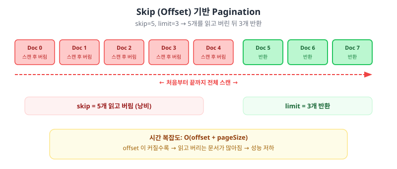
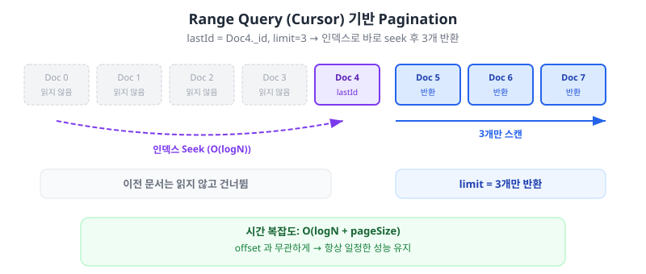

:::info
대량 데이터를 순차 조회하는 기능에서 skip + limit 기반 pagination 을 하게 되면 성능이 급격히 떨어지고 Database 의 CPU 증가하는 문제가 생길 수 있다. <br />
왜 느린지, 무엇으로 바꿨는지, 그리고 로컬에서 바로 재현하는 방법까지 정리한다.
:::

---

### Offset 기반 Pagination 동작 방식

MongoDB에서 `skip + limit` 조합을 사용하면 offset 기반 pagination이 된다.

```javascript
db.posts.find({}).sort({ _id: -1 }).skip(offset).limit(size);
```

`skip`은 결과셋의 처음부터 스캔한 뒤, 지정한 개수만큼 버리고 나서야 원하는 구간을 반환한다. <br/>
<RedText>offset이 커질수록 서버가 읽고 버리는 문서 수가 선형으로 증가한다.</RedText>

MongoDB 공식 문서에서도 이 한계를 명시하고 있다.

:::neutral
The cursor.skip() method requires the MongoDB server to scan from the beginning of the input results set before beginning to return results. As the offset increases, cursor.skip() will become slower.
Range queries can use indexes to avoid scanning large numbers of documents, providing better performance as the number of skipped documents increases.
:::

:::note
<a href="https://www.mongodb.com/docs/manual/reference/method/cursor.skip/">cursor.skip() - MongoDB Docs</a>
:::

---

### RDBMS 의 OFFSET 과 무엇이 다를까?

RDBMS(MySQL, PostgreSQL 등)의 `OFFSET` 기반 pagination도 같은 성능 문제가 있는데,
MongoDB 의 Sharded Cluster 에서는 <RedText>그 영향이 더 크게 체감</RedText>될 수 있다.

**1) 앞의 데이터를 읽고 버리는 구조는 같다**
- RDBMS 의 `OFFSET` 도 앞의 행을 모두 읽고 버리는 구조라 본질적인 한계는 같다.
- MongoDB 도 B-Tree 인덱스를 사용하지만, `skip` 시 <BlueText>인덱스 엔트리를 하나씩 순회하며 건너뛰어야</BlueText> 하고, offset 위치로 직접 점프하는 기능이 없다.

**2) 요청마다 처음부터 다시 읽는다**
- RDBMS 든 MongoDB 든 HTTP 요청 단위 페이지네이션은 <BlueText>매 요청마다 새로운 쿼리를 실행</BlueText>하므로, `skip`/`OFFSET` 은 매번 처음부터 인덱스를 순회하게 된다.

**3) 분산 환경 (Sharding)**
- Sharded Cluster 환경에서 `skip`은 각 샤드에서 결과를 모은 뒤 `mongos`에서 정렬하고 건너뛰므로, <RedText>샤드 수에 비례하여 비용이 증가</RedText>한다.
- RDBMS 의 단일 노드 기반 `OFFSET`과 비교하면 분산 환경에서의 오버헤드가 훨씬 크다.

:::warning
특히 Sharded Cluster 에서 deep paging 을 수행하면, 각 샤드에서 skip + limit 만큼의 문서를 모두 mongos로 전송한 뒤 병합하므로, 네트워크와 메모리 비용이 급격히 증가한다.
:::

---

### Spring Data MongoDB

Spring Data MongoDB에서 `PageRequest.of(page, size)`를 사용하면, 내부적으로 `offset = page * size`가 계산되고 이 값이 MongoDB의 `skip`으로 그대로 전달된다.

```java
// AbstractPageRequest.java (spring-data-commons)
public long getOffset() {
    return (long) pageNumber * (long) pageSize;
}
```

```java
// Query.java (spring-data-mongodb)
public Query with(Pageable pageable) {

    if (pageable.isPaged()) {
        this.limit = pageable.toLimit();
        this.skip = pageable.getOffset();
    }

    return with(pageable.getSort());
}
```

<RedText>page 번호가 커질수록 `skip` 값도 커지고, 성능도 같이 나빠지는 구조다.</RedText>

:::note
- <a href="https://github.com/spring-projects/spring-data-commons/blob/main/src/main/java/org/springframework/data/domain/AbstractPageRequest.java">AbstractPageRequest.java (spring-data-commons)</a>
- <a href="https://github.com/spring-projects/spring-data-mongodb/blob/main/spring-data-mongodb/src/main/java/org/springframework/data/mongodb/core/query/Query.java">Query.java (spring-data-mongodb)</a>
:::

---

### Skip vs Range Query

101번째 항목부터 500개를 가져온다고 가정하면

**Skip 방식**
1. 처음부터 스캔
2. 앞의 100개를 읽고 버림
3. 이후 500개 반환

<div style={{ textAlign: 'center' }}>
    
</div>

<br/>

**Range Query 방식**
1. 이전 페이지의 마지막 `_id`를 커서로 저장
2. `_id < lastId` 조건으로 인덱스 seek
3. 바로 다음 구간 500개 반환

<div style={{ textAlign: 'center' }}>
    
</div>

<br/>

|구분|Skip (offset)|Range (cursor)|
|--|--|--|
|내부 동작|처음부터 순차 스캔 (Linear Scan)|경계값 seek 후 스캔|
|시간 복잡도|O(offset + pageSize)|O(logN + pageSize)|
|대량 데이터|성능 급격히 저하|항상 일정한 성능 유지|

:::note
skip 은 서버가 결과를 반환하기 전 입력 결과셋의 처음부터 스캔하여 offset(skip 값) 이 커질수록 느려진다. <br/>
range 는 인덱스를 사용하여 대량의 문서 스캔을 피할 수 있고, 훨씬 나은 성능을 제공한다.
:::

---

### 코드 적용

#### 기존 코드 (skip 기반)

```java
public List<Post> getPosts(int page, int size) {
    Query query = new Query()
        .with(Sort.by(Sort.Direction.DESC, "_id"))
        .with(PageRequest.of(page, size));

    return mongoTemplate.find(query, Post.class);
}
```

#### 개선 코드 (cursor 기반)

```java
public List<Post> getPosts(String lastId, int size) {
    Query query = new Query()
        .with(Sort.by(Sort.Direction.DESC, "_id"))
        .limit(size);

    if (lastId != null) {
        query.addCriteria(Criteria.where("_id").lt(new ObjectId(lastId)));
    }

    return mongoTemplate.find(query, Post.class);
}
```

#### 대량 순회

```java
public List<Post> getAllPosts(int batchSize) {
    List<Post> allPosts = new ArrayList<>();
    String lastId = null;

    while (true) {
        List<Post> batch = getPosts(lastId, batchSize);
        if (batch.isEmpty()) break;

        allPosts.addAll(batch);
        lastId = batch.get(batch.size() - 1).getId();
    }

    return allPosts;
}
```

---

### 벤치마크 결과

#### mongosh 기준 (DB 내부 실행)

20만 건 데이터, pageSize=500 기준으로 `explain("executionStats")` 결과다.

```text
page    skip      asIsMs  toBeMs  improvement
0       0         0       -       -
1       500       0       0       -
10      5000      2       0       100.00%
100     50000     16      0       100.00%
300     150000    46      0       100.00%
```

<BlueText>skip이 커질수록 실행 시간이 선형 증가하지만, Range Query는 항상 일정하다.</BlueText> <br />
toBeMs 의 0 은 explain 의 executionTimeMillis 가 ms 단위 정수라서 1ms 미만이 0 으로 찍힌 것이고, improvement 의 100% 도 그 때문에 나온 숫자다.

#### Spring Boot 애플리케이션 경유 측정 (로컬 Docker)

`SEED=1 REPEAT=11 TOTAL_DOCS=20000 PAGE_SIZE=500 PAGES=0,1,10,20` 기준 결과:

```text
page    skip    asIsMs  toBeStepMs  improvement(step)
0       0       1.833   2.537       -38.360%
1       500     2.003   2.448       -22.178%
10      5000    3.669   2.075       43.453%
20      10000   5.226   2.058       60.624%
```

두 방식을 3회씩 미리 실행해서 워밍업한 뒤, 페이지마다 11번 재서 중앙값을 냈고, 3번 반복해도 비슷한 결과가 나왔다. <br />
page 0, 1 은 두 방식의 쿼리가 사실상 같아서 1ms 안쪽 차이는 측정 오차 수준이고, skip 이 커질수록 AS-IS 만 느려져서 page 20 에서는 cursor 가 약 2.5배 빠르다.

:::tip
<a href="https://github.com/eottabom/let-me-code/tree/main/mongodb-pagination">벤치마크 예제 코드 보러가기 (클릭)</a>
:::

---

### ⚠️ 주의사항

- <RedText>Range Query 방식은 정렬 기준 필드에 반드시 인덱스가 있어야 한다.</RedText> 인덱스가 없으면 `$lt` / `$gt` 조건이 full collection scan 으로 동작하여 skip 보다 오히려 느려질 수 있다.
  - `_id` 는 기본 인덱스가 있으므로 별도 생성이 필요 없다.
  - `_id` 가 아닌 다른 필드(예: `createdAt`)를 정렬 키로 사용한다면, 해당 필드에 인덱스를 생성해야 한다.
  ```javascript
  db.posts.createIndex({ createdAt: -1, _id: -1 });
  ```
- Cursor 방식은 **임의 페이지 점프**(예: 123페이지 바로 이동)에 적합하지 않다.
- 정렬 키가 중복될 수 있으면 누락/중복 방지를 위해 **복합 정렬 키**를 사용해야 한다.
  - 예: `createdAt DESC, _id DESC`

---

:::success
<b>정리</b>
✔ MongoDB 의 skip 기반 deep paging 은 스캔 비용 때문에 빠르게 한계에 도달한다. <br/>
✔ RDBMS 의 OFFSET 도 같은 한계가 있고, MongoDB 는 Sharded Cluster 에서 skip 비용이 mongos 와 shard 사이에서 증폭된다. <br/>
✔ _id(또는 복합 커서 키) 기반 Range Query 로 전환하면 페이지가 깊어져도 성능을 안정적으로 유지할 수 있다. <br/>
✔ 엑셀/CSV 전체 다운로드, 무한 스크롤, 배치 처리 시나리오와 같이 전체 데이터를 조회해야하는 경우 효과가 크다.
:::

---

### 📚 Reference

- [MongoDB - cursor.skip() 공식 문서](https://www.mongodb.com/docs/manual/reference/method/cursor.skip/)
- [Spring Data MongoDB - Query.java](https://github.com/spring-projects/spring-data-mongodb/blob/main/spring-data-mongodb/src/main/java/org/springframework/data/mongodb/core/query/Query.java)
- [Spring Data Commons AbstractPageRequest.java](https://github.com/spring-projects/spring-data-commons/blob/main/src/main/java/org/springframework/data/domain/AbstractPageRequest.java)

<br/><br/>
