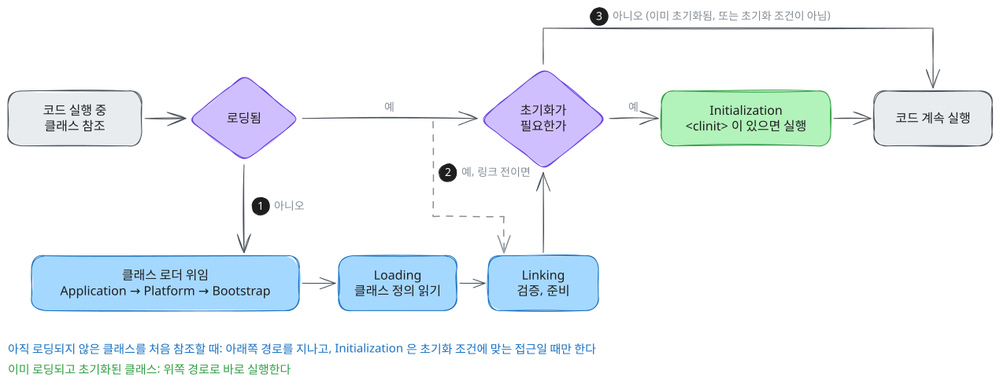
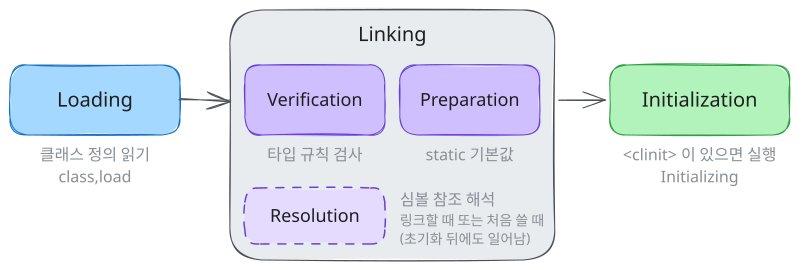
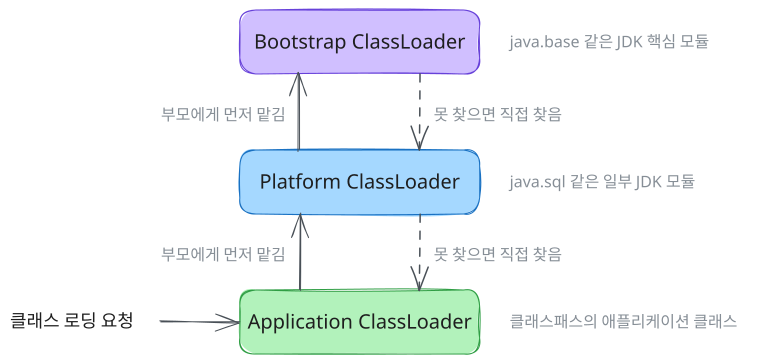
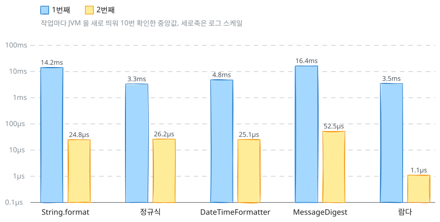

:::info
배포 직후나 어떤 기능을 처음 쓸 때만 유독 느린 경우가 있는데, <br />
String.format 을 부르는 코드도 JVM 을 띄운 뒤 처음 실행하면 10ms 넘게 걸리고, 두 번째부터는 µs 단위로 줄어든다. <br />
이 차이에는 여러 초기화가 섞여 있지만, 그중 하나는 JVM 이 클래스를 처음 쓸 때 로딩하고 초기화하는 과정이다. <br />
명세와 JDK 25 HotSpot 의 로그로 클래스가 언제 로딩되고 초기화되는지, 처음 실행하는 코드 경로가 얼마나 느린지, <br />
static 초기화가 실패하면 무엇이 남는지 따라가 보자.
:::

---

## 처음 실행과 두 번째 실행

자주 쓰는 JDK 기능 다섯 가지를 JVM 을 띄운 뒤 처음 실행할 때와 두 번째로 실행할 때의 시간은 아래와 같다.

| 작업 | 1번째 | 1번째 범위 | 2번째 | 1번째에 로딩된 클래스 |
| --- | --- | --- | --- | --- |
| String.format | 14.2ms | 13.7\~43.1ms | 24.8µs | 381개 |
| 정규식 | 3.3ms | 3.1\~6.7ms | 26.2µs | 133개 |
| DateTimeFormatter | 4.8ms | 4.1\~9.1ms | 25.1µs | 204개 |
| MessageDigest | 16.4ms | 15.5\~33.9ms | 52.5µs | 394개 |
| 람다 | 3.5ms | 3.2\~4.9ms | 1.1µs | 175개 |

macOS 의 Azul Zulu 25.0.2(aarch64)에서 작업마다 JVM 을 새로 띄워 10번 잰 중앙값이고, 범위는 그 10번 중 가장 짧은 값과 가장 긴 값이다. <br />
10번을 재기 전에 따로 띄운 첫 프로세스는 String.format 이 23.3ms 로 중앙값보다 길었다. <br />
기본 로케일은 따로 기록하지 않았는데, String.format 처럼 로케일 정보를 쓰는 작업은 로케일에 따라 로딩되는 클래스 수가 달라질 수 있다.

다섯 작업 모두 1번째 실행이 2번째보다 백 배 넘게 느렸고, 1번째 실행 동안 클래스가 133\~394개 로딩됐는데 2번째 실행에서는 0개였다. <br />
이 표는 1번째 실행에 클래스 로딩이 함께 일어났다는 것을 보여 줄 뿐, 시간 차이 중 얼마가 클래스 로딩 때문인지는 나눠서 재지 않았다. <br />
그래서 아래에서는 시간보다, 클래스가 언제 로딩되고 초기화되는지를 따라가 본다. (측정 방법은 뒤의 처음 실행하는 코드 경로의 비용 절에 있다)

---

## 한눈에 보기

한 클래스는 <BlueText>로딩(Loading) → 링킹(Linking) → 초기화(Initialization)</BlueText> 순서로 준비되고, 초기화는 조건에 맞는 접근이 있을 때만 일어난다. <br />
코드가 어떤 클래스를 참조할 때 JVM 이 거치는 흐름을 흔한 경우로 단순하게 그려보면 아래와 같다.

<figure>
    
</figure>

그림의 번호별로 보면 아래와 같다.

<StepNumber>1</StepNumber> 아직 로딩되지 않은 클래스를 처음 참조하면, 클래스 로더가 클래스를 찾아 읽고(위임, Loading) 검증과 준비(Linking)까지 마친다. <br />
<StepNumber>2</StepNumber> 이미 로딩됐지만 아직 링크 전인 클래스는, 초기화 전에 링크부터 마친다. <br />
<StepNumber>3</StepNumber> 이미 초기화됐거나 초기화 조건에 맞지 않는 접근이면, Initialization 없이 바로 실행한다.

Initialization 은 new 나 static 메서드 호출처럼 초기화 조건에 맞는 접근일 때만 일어나서, <br />
initialize 인자에 false 를 넘긴 Class.forName 이나 배열 생성처럼 로딩만 되고 초기화되지 않는 경우도 있다. <br />
각 단계가 언제 일어나는지를 로그와 명세로 확인하고, 마지막에 이 차이가 처음 실행하는 코드 경로에 얼마나 드러나는지 살펴본다.

---

## Loading, Linking, Initialization

JVM 이 클래스를 쓸 수 있게 만드는 과정은 아래와 같이 여러 단계로 나뉘는데, 뒤에서 볼 HotSpot 로그에도 단계마다 다른 줄이 찍힌다.

<figure>
    
</figure>

명세가 초기화 전에 끝나 있기를 요구하는 것은 검증과 준비까지라서, 그림에서 해석(Resolution)은 Linking 안에 두되 초기화로 가는 화살표와 떼어 그렸다. <br />
해석은 클래스 파일에 이름으로만 적혀 있는 클래스, 메서드, 필드 참조를 실제 대상에 연결하는 일인데, <br />
명세는 이를 링크할 때 미리 할 수도, 그 참조를 처음 쓸 때 할 수도 있게 허용해서 초기화가 끝난 뒤에 해석이 일어날 수도 있다.

단계마다 하는 일과 로그에서 보이는 곳을 정리하면 아래와 같다.

| 단계 | 역할 | 로그에서 보이는 곳 |
| --- | --- | --- |
| **Loading** | 클래스 로더가 클래스 정의(보통 클래스 파일)를 찾아 읽고 JVM 안에 클래스 구조를 만든다. <br />배열 클래스나 실행 중에 만드는 클래스는 파일 없이 만든다 | class,load |
| **Linking: Verification** | 바이트코드가 타입 규칙을 지키는지 검사한다 | Start/End class verification |
| **Linking: Preparation** | static 필드의 메모리를 잡고 기본값(0, null)으로 채운다 | 따로 찍히지 않음 |
| **Linking: Resolution** | 상수 풀의 심볼 참조(클래스 이름, 메서드 이름)를 실제 대상으로 바꾼다 | 따로 찍히지 않음 |
| **Initialization** | static 필드 초기값 대입과 static 블록, 즉 `<clinit>` 이 있으면 실행하고 초기화 완료로 표시한다 | Initializing |

### Loading

클래스 로더는 부모에게 먼저 맡기는 위임 구조로 되어 있어서, JDK 핵심 클래스는 Bootstrap 로더가, 일부 JDK 모듈은 Platform 로더가, 애플리케이션 클래스는 Application 로더가 읽는데([ClassLoader API 문서](https://docs.oracle.com/en/java/javase/25/docs/api/java.base/java/lang/ClassLoader.html)), 단순하게 그려보면 아래와 같다.

<figure>
    
</figure>

JDK 9 부터 Application 로더와 Platform 로더는 요청받은 클래스가 내장 로더에 정의된 이름 있는 모듈에 있으면 그 모듈을 정의한 로더에게 바로 맡기고, <br />
해당 모듈이 없을 때 부모에게 맡긴다([JEP 261 - Class loaders](https://openjdk.org/jeps/261#Class-loaders)). <br />
클래스패스에 있는 애플리케이션 클래스는 이름 있는 모듈에 속하지 않으니 그림처럼 부모를 거친 뒤 Application 로더가 읽는다.

뒤에서 볼 로그에서 source 가 file 로 시작하면 빌드 결과 폴더의 클래스 파일을 읽은 것이다. <br />
람다 구현 클래스처럼 실행 중에 만들어지는 hidden class([JEP 371](https://openjdk.org/jeps/371))는 FirstRun$$Lambda/0x... 같은 이름으로 찍히고, source 에는 파일 대신 그 클래스를 만든 클래스 이름이 남는다.

### Linking

검증은 클래스 파일이 타입 규칙을 지키는지 보는 단계인데, 뒤의 Holder 로그에서 보듯이 타입 관계를 확인하려고 다른 클래스를 로딩하기도 한다. <br />
준비 단계에서는 static 필드를 기본값으로만 채워 두고, 코드에 적힌 초기값은 초기화 단계에서 넣는다. <br />
해석도 명세가 시점을 구현에 맡기는데, HotSpot 은 심볼 참조를 쓰는 바이트코드를 처음 실행할 때 해석하는 쪽에 가깝다([JVMS 25 - 5.4.3 Resolution](https://docs.oracle.com/javase/specs/jvms/se25/html/jvms-5.html#jvms-5.4.3)).

### Initialization

초기화는 static 초기값과 static 블록을 실행하는 단계로, 로딩과 달리 언제 일어나는지가 JLS 에 정해져 있는데([JLS 25 - 12.4.1 When Initialization Occurs](https://docs.oracle.com/javase/specs/jls/se25/html/jls-12.html#jls-12.4.1)), 대표적인 경우는 아래와 같다.

- **인스턴스 생성**: new 로 그 클래스의 인스턴스를 만들 때
- **static 메서드 호출**: 그 클래스에 선언된 static 메서드를 부를 때
- **static 필드 접근**: 그 클래스에 선언된 static 필드를 읽거나 값을 넣을 때 (constant variable 은 제외)
- **리플렉션**: Class.forName 처럼 리플렉션으로 초기화를 요청할 때
- **하위 클래스 초기화**: 하위 클래스를 초기화할 때, 아직 초기화되지 않은 상위 클래스를 먼저 초기화한다

뒤의 로그에 찍히는 (no method) 는 실행할 `<clinit>` 이 없다는 뜻이고, 그래도 초기화 완료 상태로 넘어가는 단계는 똑같이 거친다.

초기화는 클래스마다 한 번만 일어나는데, JVM 은 클래스별 초기화 상태를 두고 아래와 같이 진행한다.

:::cite
Otherwise, record the fact that initialization of C is in progress by the current thread, and release LC.

(초기화 중인 스레드가 없고 실패한 상태도 아니라면) C 의 초기화가 현재 스레드에서 진행 중이라고 기록하고, 잠금 LC 를 푼다.

[JVMS 25 - 5.5 Initialization](https://docs.oracle.com/javase/specs/jvms/se25/html/jvms-5.html#jvms-5.5)
:::

잠금은 상태를 확인하고 기록하는 동안에만 잡고, `<clinit>` 은 잠금을 푼 다음에 실행한다. <br />
다른 스레드는 초기화가 진행 중이라는 상태를 보고 끝날 때까지 기다리기 때문에, 여러 스레드가 동시에 접근해도 static 블록은 한 번만 실행된다.

---

## 테스트 환경

| 항목 | 값 |
| --- | --- |
| JDK | Azul Zulu 25.0.2 (HotSpot) |
| 로그 옵션 | `-Xlog:class+load=info,class+init=info:stdout:uptime,tags` |
| 반복 | 확인할 때마다 JVM 을 새로 띄운다 |

클래스가 언제 로딩되고 초기화되는지는 JVM 의 통합 로깅으로 확인했는데, <br />
위 표의 로그 옵션으로 class+load, class+init 로그를 표준 출력(stdout)에 찍게 했다. ([Java -Xlog 문서 바로가기](https://docs.oracle.com/en/java/javase/25/docs/specs/man/java.html#enable-logging-with-the-jvm-unified-logging-framework))

JVM 로그만으로는 프로그램이 코드의 어디를 실행하는 중인지 알 수 없어서, <br />
코드의 지점마다 Marker.mark 로 [mark] 로 시작하는 줄을 System.out.println 으로 같은 표준 출력에 찍었다. <br />
두 출력이 실행 순서대로 한 화면에 섞여 나오기 때문에, [mark] 줄 바로 다음에 찍힌 로딩 로그를 보면 그 지점에서 로딩된 클래스를 알 수 있다.

이때 로거를 쓰거나 문자열을 + 로 이어 붙이면 그 기능에 필요한 클래스가 따로 로딩되어 로그에 섞이기 때문에, <br />
Marker.mark 에는 로거 없이 문자열 상수만 넘겼다.

```bash
java -Xlog:class+load=info,class+init=info:stdout:uptime,tags \
     -cp build/classes/java/main \
     com.eottabom.letmecode.example.classloading.target.LoadTiming branch
```

:::tip
<a href="https://github.com/eottabom/let-me-code/tree/main/jvm-classloading" target="_blank" rel="noopener noreferrer">예제 코드 보러가기 (클릭)</a>
:::

---

## 클래스를 불러오는 시점

JVM 은 시작할 때 애플리케이션 클래스를 한꺼번에 읽어 두지 않는다. <br />
main 을 실행하는 데 필요한 클래스부터 로딩하고, 나머지는 코드가 그 클래스를 처음 필요로 할 때 로딩하는데, 명세도 이 시점을 구현에 맡겨 두었다.

:::cite
This specification allows an implementation flexibility as to when linking activities (and, because of recursion, loading) take place, provided that all of the following properties are maintained: A class or interface is completely loaded before it is linked. A class or interface is completely verified and prepared before it is initialized.

명세는 링크(그리고 링크 과정에서 일어나는 로딩)를 언제 할지 구현이 정할 수 있게 두었고, 클래스는 링크 전에 로딩이 끝나야 하고 초기화 전에 검증과 준비가 끝나야 한다는 순서만 지키게 한다.

[JVMS 25 - 5.4 Linking](https://docs.oracle.com/javase/specs/jvms/se25/html/jvms-5.html#jvms-5.4)
:::

로딩 시점은 JVM 구현마다 다를 수 있어서, 아래 예제 코드를 HotSpot JVM 에서 실행해 직접 확인했다.

:::note
<b>HotSpot JVM</b>
HotSpot 은 OpenJDK 와 이를 바탕으로 한 Zulu 같은 JDK 에 들어 있는 JVM 구현이다.
실행 중에 자주 쓰이는 코드(hot spot)를 찾아 컴파일한다는 데서 이름이 왔다. ([Java SE 25 - JVM 기술 개요](https://docs.oracle.com/en/java/javase/25/vm/java-virtual-machine-technology-overview.html))
:::

```java
// 실행할 때 클래스 이름 뒤에 branch 를 붙이면 args[0] 이 "branch" 가 되어 분기 안으로 들어간다 (아래 로그)
//   java -Xlog:... -cp ... LoadTiming branch   → args = ["branch"]
// branch 없이 실행하면 args 가 비어 있어 분기를 타지 않는다
//   java -Xlog:... -cp ... LoadTiming          → args = []
public static void main(String[] args) {
    Marker.mark("[mark] main 시작");
    if (args.length > 0 && "branch".equals(args[0])) {
        Marker.mark("[mark] 분기 진입");
        Branch.run();               // 인자가 branch 일 때만 실행
    }
    Marker.mark("[mark] Holder.touch 호출 전");
    Holder.touch();                 // make(), unused() 는 부르지 않는다
    Marker.mark("[mark] main 끝");
}

static final class Holder {
    static void touch() { }
    static Base make() { return new Derived(); }   // 호출하지 않음
    static Unused unused() { return null; }        // 호출하지 않음
}

// [mark] 표시 줄을 표준 출력에 한 줄로 찍는다. 로거나 문자열 연결을 쓰지 않는다.
final class Marker {
    private Marker() { }

    static void mark(String line) {
        System.out.println(line);
    }
}
```

branch 인자를 주고 실행하면 아래와 같은 로그가 찍힌다. (패키지 이름은 줄였다)

```text
[mark] main 시작
[mark] 분기 진입
[0.023s][class,load] LoadTiming$Branch source: file:.../build/classes/java/main/
[0.023s][class,init] 307 Initializing 'LoadTiming$Branch'(no method)
[mark] Holder.touch 호출 전
[0.023s][class,load] LoadTiming$Holder source: file:.../build/classes/java/main/
[0.023s][class,init] Start class verification for: LoadTiming$Holder
[0.023s][class,load] LoadTiming$Base source: file:.../build/classes/java/main/
[0.024s][class,load] LoadTiming$Derived source: file:.../build/classes/java/main/
[0.024s][class,init] End class verification for: LoadTiming$Holder
[0.024s][class,init] 308 Initializing 'LoadTiming$Holder'(no method)
[mark] main 끝
```

branch 인자를 빼고 실행해서 분기를 타지 않은 경우와 함께 놓고 보면 아래와 같다.

| 클래스 | 참조 위치 | 분기 실행 안 함 | 분기 실행 |
| --- | --- | --- | --- |
| Branch | 분기 안에서 호출 | 로딩 안 됨 | 분기 진입 뒤 로딩 |
| Holder | touch() 호출 | 로딩 | 로딩 |
| Base, Derived | 호출하지 않는 make() 의 반환 타입과 반환 값 | 로딩 | 로딩 |
| Unused | 호출하지 않는 unused() 의 반환 타입, 반환 값은 null | 로딩 안 됨 | 로딩 안 됨 |

Branch 는 분기에 들어간 다음에 로딩됐고, 분기를 타지 않은 실행에서는 끝까지 로딩되지 않았다.

Base 와 Derived 는 호출하지도 않는 make() 에만 나오는데, Holder 를 검증(verification)하는 도중에 로딩됐다. <br />
검증은 메서드를 호출할 때가 아니라 클래스를 링크할 때 클래스 단위로 해서, touch() 만 불렀어도 make() 와 unused() 의 바이트코드까지 함께 검사된다.

검증기는 반환하는 값이 반환 타입에 들어갈 수 있는지 확인하는데([JVMS 25 - 4.10.1](https://docs.oracle.com/javase/specs/jvms/se25/html/jvms-4.html#jvms-4.10.1)), <br />
make() 는 Derived 객체를 Base 로 돌려주니 Derived 가 Base 의 하위 클래스인지 보려고 두 클래스를 읽었다. <br />
unused() 는 null 을 돌려주는데, null 은 어떤 참조 타입에도 들어갈 수 있어서 Unused 는 읽을 필요가 없었다. <br />
검증 중에 로딩된 Base 와 Derived 는 Initializing 줄이 없어서, 로딩까지만 되고 초기화로 이어지지 않았다([JVMS 25 - 5.4.1](https://docs.oracle.com/javase/specs/jvms/se25/html/jvms-5.html#jvms-5.4.1)).

결국 클래스 이름이 코드에 적혀 있다고 바로 로딩되지는 않고, 그 코드를 실행하거나 검증처럼 JVM 이 클래스 정보를 실제로 필요로 할 때 로딩될 수 있다. <br />
평소에 타지 않는 분기나 아직 한 번도 들어오지 않은 요청 경로의 클래스도 그래서 그 경로를 처음 실행할 때 로딩될 수 있다.

---

## 로딩과 초기화가 일어나는 시점

클래스를 어떻게 참조하느냐에 따라 로딩만 되는지, 초기화까지 되는지 확인해 봤다. <br />
경우마다 JVM 을 새로 띄웠고, 각 클래스의 static 블록이 [static] 줄을 찍게 해서 이 줄이 보이면 초기화된 것으로 봤다.

```java
// 경우마다 하나만 실행한다
Class.forName(LAZY_CLASS_NAME, false, loader);  // forName-no-init
System.out.println(Constants.LIMIT);            // constant-variable,  static final int LIMIT = 10
System.out.println(Boxed.LIMIT);                // static-final-boxed, static final Integer LIMIT = 10
System.out.println(new Element[1].length);      // array
System.out.println(Child.shared);               // subclass-static-field, shared 는 Parent 에 선언
Util.call();                                    // static-method
```

경우별로 로딩되고 초기화된 클래스는 아래와 같다.

| 경우 | 로딩 | 초기화 |
| --- | --- | --- |
| `Class.forName(name, false, loader)`, initialize 인자가 false | Lazy | 없음 |
| constant variable 읽기 (`static final int`) | 없음 | 없음 |
| `static final Integer` 읽기 | Boxed | Boxed |
| 배열 생성 (`new Element[1]`) | Element | 없음 |
| 하위 클래스를 통해 상위 클래스의 static 필드 읽기 | Parent, Child | Parent |
| static 메서드 호출 | Util | Util |

### 로딩만 되고 초기화되지 않는 경우

Class.forName 의 initialize 인자에 false 를 넘기면 클래스를 로딩하되 초기화는 하지 않아서 static 블록이 실행되지 않는다. 이 인자가 보장하는 것은 초기화하지 않는다는 점이고, 링크까지 하지 않는다는 뜻은 아니다([Class.forName API 문서](https://docs.oracle.com/en/java/javase/25/docs/api/java.base/java/lang/Class.html#forName(java.lang.String,boolean,java.lang.ClassLoader))). <br />
배열도 비슷한데, `new Element[1]` 은 배열 클래스를 만들려고 Element 를 로딩하지만 Element 인스턴스를 만든 것은 아니라서 초기화까지 가지 않는다.

### 로딩조차 되지 않는 경우

`static final int LIMIT = 10` 처럼 기본형이나 String 을 상수식으로 초기화한 static final 필드를 JLS 에서는 constant variable 이라고 부른다([JLS 25 - 4.12.4](https://docs.oracle.com/javase/specs/jls/se25/html/jls-4.html#jls-4.12.4)). <br />
컴파일러가 이 값을 읽는 쪽 클래스 파일에 10 을 그대로 넣어 두기 때문에([JLS 25 - 13.1](https://docs.oracle.com/javase/specs/jls/se25/html/jls-13.html#jls-13.1)), 실행할 때 Constants 클래스를 찾을 필요가 없고 로딩도 되지 않았다. <br />
같은 static final 이라도 Integer 로 선언하면 constant variable 이 아니어서, 필드를 읽으려면 클래스를 초기화해야 했고 static 블록도 실행됐다. <br />
값이 읽는 쪽에 들어가 있다 보니, constant variable 의 값을 바꾸면 그 값을 읽는 클래스도 다시 컴파일해야 바뀐 값이 반영된다([JLS 25 - 13.4.9](https://docs.oracle.com/javase/specs/jls/se25/html/jls-13.html#jls-13.4.9)).

### 하위 클래스를 통해 static 필드를 읽는 경우

Child.shared 처럼 상위 클래스에 선언된 static 필드를 하위 클래스 이름으로 읽었더니, Parent 와 Child 는 둘 다 로딩됐지만 초기화는 Parent 만 됐는데, JLS 에 아래와 같이 정해져 있다.

:::cite
A reference to a static field causes initialization of only the class or interface that actually declares it, even though it might be referred to through the name of a subclass, a subinterface, or a class that implements an interface.

static 필드를 참조하면, 하위 클래스나 하위 인터페이스, 인터페이스를 구현한 클래스의 이름으로 참조했더라도 그 필드를 실제로 선언한 클래스나 인터페이스만 초기화된다.

[JLS 25 - 12.4.1 When Initialization Occurs](https://docs.oracle.com/javase/specs/jls/se25/html/jls-12.html#jls-12.4.1)
:::

Child 가 로딩은 된 이유는 바이트코드에 있다. <br />
javac 는 Child.shared 를 Child 라는 이름이 적힌 필드 참조로 컴파일하고, <br />
JVM 은 이 필드 참조를 해석할 때 Child 부터 로딩한 뒤 상위 클래스인 Parent 에서 shared 를 찾는다([JVMS 25 - 5.4.3.2](https://docs.oracle.com/javase/specs/jvms/se25/html/jvms-5.html#jvms-5.4.3.2)). <br />
그래서 Child 는 로딩만 되고 초기화는 필드를 선언한 Parent 만 됐는데, <br />
이처럼 로딩과 초기화는 서로 다른 규칙으로 정해지니, static 블록이 언제 실행될지 따질 때는 <BlueText>로딩이 아니라 초기화 조건을 기준으로 보는 편이 좋다.</BlueText>

### static 초기화가 실패한 경우

초기화가 클래스마다 한 번만 일어나는 것은 실패했을 때도 마찬가지인데, static 초기화에서 예외가 나는 아래 클래스에 두 번 접근해 봤다.

```java
static final class Config {
    static final String VALUE = load();

    private static String load() {
        throw new IllegalStateException("설정 파일을 찾을 수 없다");
    }
}
```

두 번의 접근에서 받은 예외는 아래와 같다.

```text
[1번째 접근] java.lang.ExceptionInInitializerError
  cause: java.lang.IllegalStateException: 설정 파일을 찾을 수 없다
[2번째 접근] java.lang.NoClassDefFoundError: Could not initialize class ...InitFailure$Config
  cause: java.lang.ExceptionInInitializerError: Exception java.lang.IllegalStateException: 설정 파일을 찾을 수 없다 [in thread "main"]
```

1번째 접근에서는 static 초기화에서 난 예외가 ExceptionInInitializerError 로 감싸져 올라오고, JVM 은 Config 를 초기화에 실패한 상태로 표시해 둔다. <br />
2번째 접근부터는 명세의 초기화 절차대로 이 상태를 보고, static 초기화를 다시 실행하지 않은 채 곧바로 NoClassDefFoundError 를 던진다([JVMS 25 - 5.5](https://docs.oracle.com/javase/specs/jvms/se25/html/jvms-5.html#jvms-5.5)). <br />
메시지에 Could not initialize class 가 붙어 있다면 클래스 파일을 못 찾은 것이 아니라 초기화에 실패한 경우이고, 이 JDK 에서는 cause 에 처음 원인도 함께 남아 있었다.

:::danger
<b>첫 실패 로그를 찾는다</b>
NoClassDefFoundError 가 계속 쌓일 때는, 그보다 앞서 한 번만 찍힌 그 클래스의 최초 초기화 실패 로그(보통 ExceptionInInitializerError)를 찾아보는 편이 좋다.
:::

---

## 처음 실행하는 코드 경로의 비용

자주 쓰는 JDK 기능 다섯 가지로, 같은 작업을 처음 실행할 때와 두 번째로 실행할 때를 비교했다.

```java
case "format"   -> String.format("%s-%d", "order", i);
case "regex"    -> Pattern.compile("([a-z]+)-(\\d+)").matcher("order-42").matches();
case "datetime" -> DateTimeFormatter.ofPattern("yyyy-MM-dd HH:mm").format(LocalDateTime.of(2026, 11, 10, 9, i % 60));
case "digest"   -> MessageDigest.getInstance("SHA-256").digest(INPUT);  // INPUT = "order-42".getBytes(UTF_8)
case "lambda"   -> { Supplier<String> supplier = () -> "order"; yield supplier.get(); }
```

시간은 로그 출력이 섞이지 않도록 -Xlog 없이 System.nanoTime 으로 확인했고, 클래스 수는 `-Xlog:class+load` 를 켜고 실행 앞뒤에 표시 줄을 찍어 따로 셌다. <br />
작업마다 JVM 을 새로 띄워 10번 확인한 중앙값은 맨 앞의 표와 같고, 값의 차이가 커서 세로축을 로그 스케일로 그려보면 아래와 같다.

<figure>
    
</figure>

### 1번째와 2번째 실행

1번째 실행에 로딩된 클래스를 패키지별로 보면, 람다는 175개 중 159개가 람다 구현 클래스를 실행 중에 만드는 java.lang.invoke, jdk.internal.classfile 쪽 클래스였고([LambdaMetafactory API 문서](https://docs.oracle.com/en/java/javase/25/docs/api/java.base/java/lang/invoke/LambdaMetafactory.html)), <br />
MessageDigest 는 보안 프로바이더 목록을 꾸리는 sun.security.jca 클래스가 함께 로딩됐다([JCA Reference Guide](https://docs.oracle.com/en/java/javase/25/security/java-cryptography-architecture-jca-reference-guide.html)).

1번째 실행 시간에는 객체 생성, 내부 캐시 초기화 같은 비용도 들어 있어서 전부 클래스 로딩 탓으로 돌릴 수는 없다. <br />
새로 로딩되는 클래스가 0개인 2번째 실행 뒤에도 같은 작업을 계속 반복하면 측정 시간이 더 줄었는데, 클래스 로딩이 끝난 뒤에도 다른 준비 과정이 이어질 수 있어서 1번째와 2번째의 차이도 클래스 로딩만의 비용으로 읽을 수는 없다. <br />
이 결과에서 확인한 것은 <BlueText>처음 실행하는 코드 경로에서 그 경로의 클래스가 함께 로딩됐고, 그 실행이 2번째보다 크게 느렸다</BlueText>는 점이다.

:::warning
<b>측정 조건</b>
1번째 실행 시간은 디스크 캐시 같은 실행 환경에 따라 달라질 수 있는데, 캐시가 비어 있는 조건은 따로 확인하지 않았다.
:::

---

## 정리

:::success
<b>요약</b>
✔ JVM 은 클래스를 코드가 처음 필요로 할 때 로딩하고, 로딩 시점은 구현에 맡겨져 있지만 초기화 시점은 JLS 에 정해져 있다<br />
✔ 검증은 클래스 단위로 해서, 호출하지 않는 메서드에 나오는 클래스도 타입 관계를 확인하려고 로딩될 수 있다<br />
✔ static 필드는 선언한 클래스만 초기화하고, constant variable 은 읽는 쪽에 값이 들어가 있어 이 실험에서는 선언한 클래스가 로딩되지 않았다<br />
✔ 처음 실행하는 코드 경로에서는 그 경로의 클래스가 함께 로딩됐고, 이 테스트에서 1번째 실행은 2번째보다 백 배 넘게 느렸다<br />
✔ static 초기화가 한 번 실패한 클래스는 다시 초기화하지 않고, 이후 접근은 NoClassDefFoundError 가 된다
:::

상황별로 확인할 것을 정리하면 아래와 같다.

| 상황 | 확인할 것 |
| --- | --- |
| static 블록이 언제 실행될지 궁금할 때 | 로딩이 아니라 JLS 의 초기화 조건 |
| 상수를 바꿨는데 다른 클래스에 반영되지 않을 때 | 그 필드가 constant variable 인지 |
| 어떤 코드 경로의 처음 실행만 느릴 때 | 그 구간에 로딩된 클래스 (class+load 로그) |
| 요청마다 Could not initialize class 가 날 때 | 그 클래스의 최초 초기화 실패 로그 |

처음 실행하는 경로의 클래스 로딩은 없앨 수 없지만, 그 경로를 먼저 한 번 실행해 앞당길 수 있다.

---

## 📚 Reference

**명세**

* [JVMS 25 - Chapter 5. Loading, Linking, and Initializing](https://docs.oracle.com/javase/specs/jvms/se25/html/jvms-5.html)
* [JVMS 25 - 4.10 Verification of class Files](https://docs.oracle.com/javase/specs/jvms/se25/html/jvms-4.html#jvms-4.10)
* [JLS 25 - 12.4 Initialization of Classes and Interfaces](https://docs.oracle.com/javase/specs/jls/se25/html/jls-12.html#jls-12.4)
* [JLS 25 - 4.12.4 final Variables (constant variable)](https://docs.oracle.com/javase/specs/jls/se25/html/jls-4.html#jls-4.12.4)
* [JLS 25 - 13.1 The Form of a Binary](https://docs.oracle.com/javase/specs/jls/se25/html/jls-13.html#jls-13.1)

**JDK 문서**

* [Java SE 25 - Java 명령 (-Xlog)](https://docs.oracle.com/en/java/javase/25/docs/specs/man/java.html)
* [Java SE 25 - ClassLoader](https://docs.oracle.com/en/java/javase/25/docs/api/java.base/java/lang/ClassLoader.html)
* [Java SE 25 - LambdaMetafactory](https://docs.oracle.com/en/java/javase/25/docs/api/java.base/java/lang/invoke/LambdaMetafactory.html)
* [Java SE 25 - Java Virtual Machine Technology Overview](https://docs.oracle.com/en/java/javase/25/vm/java-virtual-machine-technology-overview.html)
* [Java SE 25 - Java Cryptography Architecture Reference Guide](https://docs.oracle.com/en/java/javase/25/security/java-cryptography-architecture-jca-reference-guide.html)

**JEP**

* [JEP 261 - Module System](https://openjdk.org/jeps/261)
* [JEP 371 - Hidden Classes](https://openjdk.org/jeps/371)
