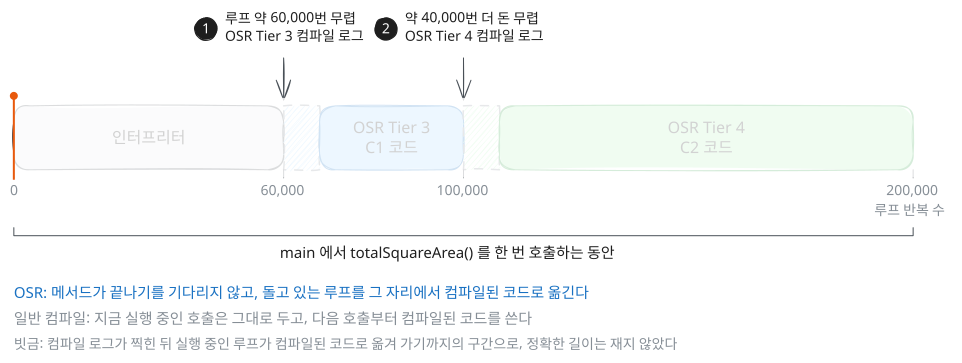

:::info
[JVM 클래스 로딩과 초기화](/post/jvm-class-loading) 에서는 처음 실행하는 코드 경로에서 클래스가 로딩되고 초기화되는 시점을 살펴봤다. <br />
클래스 로딩이 끝난 뒤에도 같은 호출을 반복하면 실행 시간이 더 줄어드는데, 여기에는 HotSpot 의 JIT 컴파일이 영향을 준다. <br />
JDK 25 의 컴파일 로그와 OpenJDK 소스로 Tier 가 언제 바뀌는지, 플래그 기본값과 실제 전환이 어떻게 다른지, <br />
OSR, inlining, deoptimization 이 어떻게 일어나는지 따라가 보자.
:::

---

## JIT 컴파일 과정

도형의 넓이를 구하는 아래 area 메서드를 예로, HotSpot 이 메서드를 실행하는 과정을 따라가면서 확인해 보자.

```java
interface Shape { double area(); }
record Circle(double r) implements Shape { ... }
record Square(double side) implements Shape { ... }

static double area(Shape shape) {
    return shape.area();
}
```

<figure>
    <picture>
        <source media="(prefers-reduced-motion: reduce)" srcSet="/img/post/java/jvm-jit-tiered-compilation/jit-overview.excalidraw.svg" />
        
    </picture>
</figure>

javac 가 만드는 클래스 파일에는 특정 CPU 에 묶이지 않은 바이트코드가 들어 있고, HotSpot 은 처음에 모든 메서드를 인터프리터로 실행한다. <br />
인터프리터는 바이트코드를 하나씩 해석하며 실행해서, 기계어로 바로 실행할 때보다 느리다.

컴파일에도 CPU 와 시간이 들기 때문에, HotSpot 은 메서드마다 호출 수와 루프 반복 수를 세고 기준을 넘긴 메서드만 기계어로 컴파일한다. <br />
그림처럼 호출도 반복도 적은 설정 읽기나 통계 출력은 인터프리터로 두고, 계속 불리는 area 만 컴파일하는 식이다. <br />
이렇게 실행 중에 필요한 메서드만 골라 컴파일하는 방식을 JIT(Just-In-Time) 컴파일이라고 한다.

JIT 컴파일러는 C1 과 C2 두 가지가 있는데, C1 은 컴파일이 빨리 끝나는 대신 최적화를 적게 하고, C2 는 컴파일에 시간이 더 걸리는 대신 더 빠른 코드를 만든다. <br />
기본 설정에서는 C1 으로 먼저 컴파일하고, C1 코드는 실행하면서 shape 로 어떤 클래스가 들어오는지 같은 정보(프로파일)를 기록한다. <br />
프로파일이 쌓이면 C2 는 shape 가 늘 Circle 이라고 가정하고, shape.area() 호출 대신 Circle.area 를 바로 계산하도록 다시 컴파일한다. <br />
그러다 Square 가 들어와 가정이 깨지면, 그 컴파일 코드는 더 쓰지 않고 인터프리터로 돌아간다.

이 과정은 메서드마다 따로 일어나서, 서버를 띄운 직후에는 자주 불리는 메서드부터 차례로 컴파일되고 요청 처리도 그만큼 점점 빨라진다.

---

## 반복할수록 줄어드는 호출 시간

이 과정이 실제로 어떻게 나타나는지 보려고, 도형 크기 256개를 받아 넓이를 모두 더하는 totalArea 메서드를 2만 번 부르면서 호출마다 시간을 재 보았다. <br />
C1 과 C2 중 어느 쪽을 쓸지는 실행 옵션으로 바꿀 수 있어서, 같은 프로그램을 아래 네 가지 실행 모드로 띄워 비교해 보았다.

| 실행 모드 | 옵션 | 동작 |
| --- | --- | --- |
| 인터프리터만 | `-Xint` | JIT 컴파일을 끄고, 끝까지 바이트코드를 한 줄씩 해석한다 |
| C1 만 | `-XX:TieredStopAtLevel=1` | C1 까지만 쓰고 C2 는 쓰지 않는다 |
| C2 만 | `-XX:-TieredCompilation` | 단계 컴파일을 끄고, 인터프리터에서 바로 C2 로 간다 |
| 기본 (Tiered) | 없음 | C1 을 거쳐 C2 로 간다 |

실행 모드마다 호출 구간별로 어떤 코드가 돌았고 호출 한 번에 얼마나 걸렸는지 정리하면 아래와 같다. <br />
칸 안의 숫자는 시간을 잰 실행에서 낸 호출 한 번 시간의 중앙값이다. <br />
칸의 색은 컴파일 로그를 켠 별도 실행에서 본 Tier 중 구간 중앙값에 해당하는 대표 단계라, 한 구간 안에서 단계가 바뀐 경우도 있다. <br />
칸의 경계는 구간을 나눈 곳일 뿐이다.

<figure>
    
</figure>

결과를 보니 인터프리터만 쓰면 끝까지 4µs(4,000ns) 안팎에 머물렀는데, <br />
C1 만 쓴 실행은 100번 남짓, C2 만 쓴 실행은 700번 안팎에서 호출 시간이 250ns 이하로 내려가 열 배 넘게 빨라져 있었다.

그 뒤 250ns 와 208ns 는 System.nanoTime 을 부르는 비용과 타이머 해상도(약 41.7ns)가 크게 섞인 값이라 어느 쪽이 더 빠른지는 말하기 어렵고, <br />
그보다 C2 만 쓰면 컴파일되기 전까지 더 오래 인터프리터 속도로 실행된다는 점이 보인다.

totalArea 는 루프를 도는 메서드라 OSR 컴파일도 함께 일어나서, 이 시간 변화를 메서드 컴파일만으로 설명할 수는 없다. <br />
기본 설정은 C1 의 빠른 시작과 C2 의 최적화를 함께 얻으려고 <BlueText>C1 으로 먼저 빨라졌다가 C2 로 한 번 더 빨라지는데</BlueText>, 이 전환이 언제 어떤 기준으로 일어나는지 따라가 보자.

---

## 실행 단계 (Tier 0~4)

기본 설정만 두 번에 걸쳐 빨라진 것은, Tiered Compilation 이 인터프리터, C1, C2 를 다섯 단계(Tier)로 나누고, 메서드의 성격과 호출 횟수에 따라 단계를 옮겨 가기 때문이다.

단계를 보기 전에, 코드를 실행하는 세 가지가 각각 무슨 일을 하는지 비교하면 아래와 같다.

| 구분 | 인터프리터 | C1 | C2 |
| --- | --- | --- | --- |
| 하는 일 | 바이트코드를 한 줄씩 해석해 실행 | 메서드를 기계어로 빠르게 컴파일 | 시간을 들여 더 최적화한 기계어로 컴파일 |
| totalArea 한 번 호출 | 약 4,000ns | 250ns (C1 만) | 208ns (C2 만) |
| 컴파일 시간 | 없다 (바로 실행) | 짧다 | 길다 |
| 최적화 근거 | 없다 | 코드만 보고 최적화한다 | C1 코드가 실행하며 모은 프로파일을 쓴다 |
| Inlining 크기 기준 | 없다 | 35 바이트 (C1MaxInlineSize) | 35 바이트, 자주 불리면 325 바이트 (MaxInlineSize, FreqInlineSize) |
| 프로파일로 세운 가정 | 없다 | 없다 | 있고, 가정이 깨지면 그 코드를 더 쓰지 않는다 (Deoptimization) |

Tiered Compilation 은 이 셋을 아래 다섯 단계로 나눈다.

| Tier | 실행하는 것 | 프로파일 | 쓰이는 경우 |
| --- | --- | --- | --- |
| **0** | 인터프리터 | 호출 수, 루프 반복 수 등 | 대부분의 메서드가 시작하는 단계 |
| **1** | C1 컴파일 코드 | 없음 | 더 최적화할 것이 없는 단순한 메서드 |
| **2** | C1 컴파일 코드 | 호출 수, 루프 반복 수만 | C2 대기열이 길 때 잠깐 거쳐 가는 단계 |
| **3** | C1 컴파일 코드 | 분기 빈도, 타입 등 전부 | C2 로 가기 전에 프로파일을 모으는 단계 |
| **4** | C2 컴파일 코드 | 없음 (모은 프로파일로 최적화) | 충분히 자주 불린 메서드 |

Tier 1, 2, 3 은 모두 C1 코드이고 프로파일을 모으는 코드를 얼마나 넣는지만 다른데, C2 가 최적화에 쓰는 "이 자리에는 Circle 만 들어온다" 같은 통계는 Tier 3 코드가 모은다.

한 메서드가 이 단계들을 거치는 흐름을 기본값 기준으로 단순하게 그려보면 아래와 같고, C2 대기열이 길 때만 거쳐 가는 Tier 2 는 점선으로 표시했다.

<figure>
    <picture>
        <source media="(prefers-reduced-motion: reduce)" srcSet="/img/post/java/jvm-jit-tiered-compilation/tier-flow.excalidraw.svg" />
        
    </picture>
</figure>

그림의 번호별로 보면 아래와 같다.

<StepNumber>1</StepNumber> 인터프리터로 약 200번 호출되면, 프로파일을 모으는 Tier 3 코드로 컴파일한다. <br />
<StepNumber>2</StepNumber> Tier 3 에서 약 5,000번 더 호출되면, 모은 분기 빈도와 타입 정보로 C2 가 Tier 4 코드를 만든다. <br />
<StepNumber>3</StepNumber> 상수를 돌려주는 getter 처럼 더 최적화할 것이 없는 메서드는, Tier 1 로 컴파일하고 끝낸다. <br />
<StepNumber color="red">4</StepNumber> C2 가 프로파일을 보고 세운 가정이 깨지면, 그 컴파일 코드는 더 쓰지 않고 인터프리터로 돌아가 다시 컴파일한다.

보통의 경로가 0 → 3 → 4 인 것은 Tier 3 에서 모은 프로파일을 C2 가 최적화에 쓰기 때문인데, 그 대신 Tier 3 코드는 프로파일 수집에 따른 추가 비용이 있다. <br />
기본 설정의 101\~1,000번째 구간(625ns)이 C1 만 쓴 경우(250ns)보다 느려서 프로파일 수집이 요인일 수 있지만, 옵션과 컴파일 경로가 달라 비교만으로 원인을 알 수 없다.

:::note
메서드는 인터프리터(Tier 0)로 시작해, 프로파일을 모으는 C1 코드(Tier 3)를 거쳐 C2 코드(Tier 4)로 옮겨 간다. <br />
더 최적화할 것이 없는 단순한 메서드는 C1 코드(Tier 1)에서 끝나고, C2 대기열이 길면 Tier 2 를 잠깐 거친다.
:::

---

## 테스트 환경

| 항목 | 값 |
| --- | --- |
| JDK | Azul Zulu 25.0.2 (HotSpot), macOS, aarch64 |
| 컴파일 로그 | `-Xlog:jit+compilation=debug:stdout:none` |
| 시간 측정 | 호출 앞뒤의 System.nanoTime 차이, 표시 줄 없이 2만 번 연속 호출 (결과는 volatile 필드에 써서 계산이 지워지지 않게 했다) |
| 반복 | 확인할 때마다 JVM 을 새로 띄운다 (전환 시점, OSR, 실행 모드는 10번) |

JMH 같은 도구는 빨라진 뒤의 평균 시간을 재는 데 맞춰져 있어서, 시간이 바뀌는 과정을 컴파일 로그와 함께 보려고 호출마다 직접 재 보았다.

컴파일 로그는 어떤 메서드가 몇 번 Tier 로 컴파일되기 시작했는지를 한 줄씩 찍는데, <br />
메서드를 100번 부를 때마다 `[mark] calls=N` 줄을 같은 표준 출력에 찍게 해 두고, 컴파일 로그가 어느 표시 줄 뒤에 나오는지로 몇 번째 호출 무렵인지 확인해 보았다.

```text
[mark] calls=200
  27       3       ...TierTransition::squareOrCircle (26 bytes)  ← 컴파일 ID, Tier, 메서드
...
[mark] calls=5400
  34       4       ...TierTransition::squareOrCircle (26 bytes)
```

컴파일은 별도 컴파일러 스레드에서 일어나서, 그대로 두면 컴파일 로그가 찍히기 전에 main 스레드가 수백 번을 더 부르게 된다. <br />
그래서 Tier 전환과 OSR 실험에서는 표시 줄마다 2ms 씩 멈춰 로그가 실제 호출 시점 가까이에 찍히게 해 두었고, 시점도 표시 단위(100번, OSR 은 5,000번)로만 보았다. <br />
또 이 실험들은 컴파일 대기열이 길게 밀리는 상황은 재현하지 않아서, 그때의 동작(scale 이 커지거나 Tier 2 를 거치는 경우)은 확인하지 못했다.

:::tip
<a href="https://github.com/eottabom/let-me-code/tree/main/jvm-jit" target="_blank" rel="noopener noreferrer">예제 코드 보러가기 (클릭)</a>
:::

---

## Tier 가 바뀌는 시점

여기서는 컴파일이 언제 요청되는지를 보고, 요청 뒤 호출 시간이 실제로 언제 줄어드는지는 뒤의 빨라지기 시작한 호출 절에서 따로 본다. <br />
앞의 흐름 그림에 적은 약 200번, 약 5,000번은 플래그 기본값에서 온 숫자라, 실제로도 그 무렵에 바뀌는지 성격이 다른 세 메서드로 확인해 보았다. <br />
메서드마다 JVM 을 새로 띄워 2만 번씩 불렀는데, 메서드에 따라 전환 시점이 꽤 달랐다.

```java
static int squareSides() {              // 정사각형 변의 수, 상수만 돌려준다
    return 4;
}

static long squareArea(long side) {      // 정사각형 넓이, 분기도 호출도 없다
    return side * side;
}

static long squareOrCircle(long size) {  // 짝수면 정사각형, 홀수면 원의 넓이, 분기가 있다
    if (size % 2 == 0) {
        return size * size;
    }
    return size * size * 314 / 100;
}
```

각 단계의 컴파일 로그가 찍힌 호출 수는 아래와 같이 나왔다. (10번 실행의 중앙값 [최소 \~ 최대]) <br />
숫자는 로그 바로 앞의 표시 값이라, 실제 로그는 그 뒤 100번 안에서 찍혔다.

| 메서드 | Tier 1 | Tier 3 | Tier 4 |
| --- | --- | --- | --- |
| squareSides | 200 [100\~200] | 없음 | 없음 |
| squareArea | 없음 | 200 [200\~300] | <RedText>1,400</RedText> [1,300\~1,400] |
| squareOrCircle | 없음 | 200 [200\~300] | 5,400 [5,400\~5,500] |

### 소스로 확인한 전환 기준

왜 이렇게 나왔는지 보려고 먼저 전환 기준이 되는 플래그의 기본값을 `-XX:+PrintFlagsFinal` 로 확인해 보았는데, 아래와 같았다.

| 플래그 | 기본값 | 쓰이는 곳 |
| --- | --- | --- |
| Tier3InvocationThreshold | 200 | Tier 0 → 3, 호출 수 |
| Tier3MinInvocationThreshold, Tier3CompileThreshold | 100, 2,000 | Tier 0 → 3, 호출 수 + 루프 반복 수 |
| Tier4InvocationThreshold | 5,000 | Tier 3 → 4, 호출 수 |
| Tier4MinInvocationThreshold, Tier4CompileThreshold | 600, 15,000 | Tier 3 → 4, 호출 수 + 루프 반복 수 |
| Tier3BackEdgeThreshold, Tier4BackEdgeThreshold | 60,000, 40,000 | OSR, 루프 반복 수 |

이 값만 보면 "200번 부르면 C1, 5,000번 부르면 C2" 로 읽기 쉬운데, OpenJDK 25.0.2 의 컴파일 정책 소스를 찾아보니 Tier 0 → 3 전환을 아래 식으로 판정하고 있었다.

:::cite
return (i >= Tier3InvocationThreshold * scale) || <br />
       (i >= Tier3MinInvocationThreshold * scale && i + b >= Tier3CompileThreshold * scale);

[OpenJDK 25.0.2 - compilationPolicy.cpp](https://github.com/openjdk/jdk25u/blob/jdk-25.0.2-ga/src/hotspot/share/compiler/compilationPolicy.cpp#L357-L358)
:::

`i` 는 메서드 호출 수, `b` 는 루프 반복 수(backedge), `scale` 은 컴파일 대기열이 길어질수록 커지는 배율이다(코드 캐시 상태나 메서드별 설정도 이 값에 영향을 준다). <br />
설명을 위해 `scale` 을 1 로 두면, 호출 수가 200 이상이면 되고, 호출 수가 100 이상인 상태에서 호출 수와 루프 반복 수의 합이 2,000 이상이어도 Tier 3 으로 간다. <br />
같은 식을 Tier3 대신 Tier4 플래그로 Tier 3 → 4 에도 쓰는데, 이때 `i` 와 `b` 는 Tier 3 에서 프로파일을 시작한 뒤 새로 센 값이다.

같은 소스를 더 보니 이 식을 건너뛰는 경우도 두 가지 있었다.

- **단순한 메서드**: getter, setter, 상수를 돌려주는 메서드처럼 단순한 메서드는 C1 컴파일만으로 충분하다고 보고, 프로파일 없이 Tier 1 로 바로 컴파일한다 (is_trivial)
- **프로파일할 것이 없는 메서드**: 분기나 다른 메서드 호출처럼 프로파일할 대상이 없는 메서드는, Tier 3 에서 Tier 4 로 갈 때 임계값을 보지 않는다 (would_profile)

또 인터프리터와 Tier 3 코드는 호출할 때마다 런타임에 알리지 않고, 2^N 번마다 한 번씩 알린다. <br />
기본값은 인터프리터의 호출이 2^7(128)번, Tier 3 코드의 호출이 2^10(1,024)번마다라서, <BlueText>전환은 임계값보다 조금 늦게 판정될 수 있다.</BlueText>

이 기준을 알고 앞의 결과를 다시 보니, 숫자가 그렇게 나온 이유가 아래와 같이 설명됐다.

- **squareSides**: 단순한 메서드인지는 판정 식보다 먼저 검사해서, 인터프리터가 처음 알리는 128번째 호출 무렵 Tier 1 로 컴파일하고 끝났다. 200번째 뒤에 로그가 나온 실행도 있었는데, 로그를 컴파일러 스레드에서 찍어서 조금 늦게 나온 것으로 보인다.
- **squareArea**: 128번째 알림에서는 200 에 못 미쳐, 두 번째 알림인 256번째 무렵 Tier 3 이 됐고, 그 뒤로는 모을 프로파일이 없어 5,000번을 기다리지 않고 Tier 3 코드가 처음 알리는 1,024번째 호출에서 Tier 4 로 갔다. 로그에 찍힌 1,300\~1,400번도 256 + 1,024 = 1,280 을 조금 넘긴 값이었다.
- **squareOrCircle**: if 가 어느 쪽으로 가는지 모아야 해서, Tier 3 이후로 센 호출이 Tier4InvocationThreshold(5,000) 를 채운 5,400번 무렵 Tier 4 가 됐다.

---

## OSR (On-Stack Replacement)

앞의 기준은 메서드를 여러 번 부를 때의 이야기인데, main 처럼 한 번만 부르는 메서드 안에서 루프를 오래 돌면 메서드가 끝나기를 기다릴 수 없다. <br />
이럴 때 HotSpot 은 실행 중인 메서드의 루프 반복 수(b)를 주된 신호로 컴파일을 요청하고, 컴파일된 코드가 준비되면 돌고 있는 루프를 그 코드로 옮기는데 이를 OSR 이라고 한다. <br />
루프만 떼어 컴파일하는 것이 아니라, 루프 시작 지점에서 들어갈 수 있는 메서드의 컴파일 버전을 따로 만드는 것이다.

```java
static long totalSquareArea(String[] marks) {  // main 에서 한 번만 부른다
    long sum = 0;
    for (int i = 1; i <= 200_000; i++) {           // 변의 길이 1~200,000 인 정사각형 넓이를 모두 더한다
        sum += (long) i * i;
        if (i % 5_000 == 0) {                       // 5,000번마다 [mark] loop=N 을 찍는다
            Marker.markAndPause(marks[i / 5_000]);
        }
    }
    return sum;
}
```

OSR 컴파일은 로그에 `%` 표시와 루프가 시작하는 바이트코드 위치(@ 4)가 붙는데, 처음 찍힌 루프 반복 수를 확인해 보니 아래와 같았다.

```text
[mark] loop=60000
  12 %     3       ...Osr::totalSquareArea @ 4 (44 bytes)
[mark] loop=105000
  14 %     4       ...Osr::totalSquareArea @ 4 (44 bytes)
```

| 메서드 | OSR Tier 3 | OSR Tier 4 |
| --- | --- | --- |
| totalSquareArea | 60,000 [60,000\~60,000] | 105,000 [105,000\~110,000] |

한 번의 호출 안에서 루프 반복 수에 따라 OSR 컴파일 로그가 찍힌 시점을 그려보면 아래와 같다.

<figure>
    <picture>
        <source media="(prefers-reduced-motion: reduce)" srcSet="/img/post/java/jvm-jit-tiered-compilation/osr-loop.excalidraw.svg" />
        
    </picture>
</figure>

확인해 보니 OSR Tier 3 은 Tier3BackEdgeThreshold(60,000) 무렵에, OSR Tier 4 는 거기서 Tier4BackEdgeThreshold(40,000) 를 더 돈 100,000번을 조금 넘긴 105,000번 무렵에 시작됐다. <br />
로그는 컴파일이 시작된 시점을 보여 주는 것이라, 실행 중인 루프가 컴파일된 코드로 옮겨 가는 정확한 순간은 그보다 조금 뒤일 수 있다.

:::note
OSR 은 한 번 부른 메서드 안의 긴 루프를, 메서드가 끝나기 전에 컴파일된 코드로 옮기는 방법이다. <br />
호출 수가 아니라 루프 반복 수를 주된 기준으로 판정하고, 컴파일 로그에 % 가 붙는다.
:::

---

## Inlining

JIT 컴파일한 코드가 빨라지는 큰 이유 중 하나는, 자주 부르는 작은 메서드를 호출한 쪽 코드에 합쳐 호출 자체를 없애는 inlining 이다. <br />
크기가 다른 세 넓이 메서드를 부르는 sumAreas 를 반복해서 부르고, sumAreas 를 컴파일할 때의 판정을 `-XX:+UnlockDiagnosticVMOptions -XX:+PrintInlining` 으로 확인해 보았다. (PrintInlining 은 진단용 옵션이라 앞의 옵션을 함께 줘야 한다)

```java
static double squareArea(double side) {                  // 정사각형 넓이, 4 바이트
    return side * side;
}

static double triangleArea(double a, double b, double c) {  // 헤론의 공식으로 구한 삼각형 넓이, 63 바이트
    if (a + b <= c || a + c <= b || b + c <= a) {
        return 0;
    }
    double s = (a + b + c) / 2;
    return Math.sqrt(s * (s - a) * (s - b) * (s - c));
}

static double manyShapesArea(double size) {               // 정다각형 40개의 넓이를 풀어 쓴 704 바이트
    double sum = 0;
    sum += 1.0 * (size + 1) * (size + 1);
    sum += 3.14159 * (size + 2) * (size + 2);
    // ... 40줄
    return sum;
}

static double sumAreas(double size) {
    return squareArea(size) + triangleArea(size, size + 1, size + 2) + manyShapesArea(size);
}
```

| 메서드 | 크기 | C1 (Tier 3) | C2 (Tier 4) |
| --- | --- | --- | --- |
| squareArea | 4 바이트 | inline | inline (hot) |
| triangleArea | 63 바이트 | failed to inline: callee is too large | inline (hot) |
| manyShapesArea | 704 바이트 | failed to inline: callee is too large | <RedText>failed to inline: hot method too big</RedText> |

C1 과 C2 가 sumAreas 를 컴파일한 결과를 그려보면 아래와 같다.

<figure>
    <picture>
        <source media="(prefers-reduced-motion: reduce)" srcSet="/img/post/java/jvm-jit-tiered-compilation/inlining.excalidraw.svg" />
        
    </picture>
</figure>

여기서 크기는 소스 줄 수나 기계어 크기가 아니라, 로그의 (63 bytes) 처럼 찍히는 바이트코드 크기다. <br />
C1 은 C1MaxInlineSize(35 바이트) 보다 큰 메서드를 합치지 않아서 squareArea 만 합쳤다. <br />
C2 는 자주 불리지 않는 메서드에는 MaxInlineSize(35 바이트), 자주 불리는 메서드에는 FreqInlineSize(325 바이트) 를 기준으로 삼는데([Java 명령 문서](https://docs.oracle.com/en/java/javase/25/docs/specs/man/java.html)), <br />
자주 불리는지는 Tier 3 에서 모은 호출 횟수로 판단하는데, 두 값은 이 환경의 기본값일 뿐이고 실제로 합칠지는 크기 외에도 호출 깊이나 컴파일러의 여러 제한에 따라 정해진다. <br />
triangleArea 는 자주 불려서 325 바이트 기준으로 합쳐졌고, manyShapesArea 는 그보다 커서 C2 에서도 합쳐지지 않았다.

:::note
Inlining 은 자주 부르는 작은 메서드를 호출한 쪽 코드에 합쳐 호출 자체를 없애는 최적화다. <br />
크기 기준은 C1 이 35 바이트, C2 는 자주 불리는 메서드라면 325 바이트이고, 이 실험에서는 704 바이트인 manyShapesArea 가 C1, C2 모두에서 합쳐지지 않았다.
:::

---

## Deoptimization

컴파일된 코드는 타입, 분기, 클래스 구조 같은 가정 위에서 최적화되는데, 그 가정이 깨지면 실행 중이던 프레임은 인터프리터로 돌아가고 그 컴파일 코드는 새 호출에 쓰지 않는다. <br />
여기서는 C2 가 Tier 3 에서 모은 타입 프로파일로 세운 가정이 깨지는 경우를 확인했다. <br />
맨 앞의 area 예시처럼 Circle 만 넘기던 메서드에 Square 를 넘기면 어떻게 되는지 실제로 확인해 보았다.

```java
static double area(Shape shape) {
    return shape.area();                  // 앞의 5만 번은 Circle, 그 뒤 5만 번은 Square
}
```

컴파일 로그와 deoptimization 로그(`-Xlog:deoptimization=debug`)를 켜고 실행해 보니 아래와 같이 나왔다. (일부 출력은 줄였다)

```text
  14       3       ...Deopt::area (7 bytes)
  17       4       ...Deopt::area (7 bytes)
[mark] Square 시작
  17       4       ...Deopt::area (7 bytes)   made not entrant: uncommon trap
  18       4       ...Deopt::area (7 bytes)

level=4 trap_bci=1 reason=class_check action=maybe_recompile
```

같은 프로그램을 앞의 Inlining 절처럼 PrintInlining 을 켜고 따로 실행해, C2 가 area 를 컴파일할 때 shape.area() 호출 자리에 무엇을 합쳤는지도 보았는데, 아래와 같았다. (패키지 이름과 일부 출력은 줄였다)

```text
@ 1   Deopt$Circle::area (14 bytes)   inline (hot)   TypeProfile (10289/10289 counts) = Deopt$Circle
[mark] Square 시작
@ 1   Deopt$Circle::area (14 bytes)   inline (hot)
      Deopt$Square::area (10 bytes)   inline (hot)   TypeProfile (1062/22565 counts) = Deopt$Square
                                                     TypeProfile (21503/22565 counts) = Deopt$Circle
```

로그를 보니 Circle 만 들어오는 동안 모인 프로파일에서 shape 는 늘 Circle 이었고(10,289번 중 10,289번, 실행마다 조금씩 다르다), <br />
C2 는 이를 믿고 shape.area() 자리에 Circle.area 를 합쳐 컴파일해 두었다. <br />
Square 가 들어오자 실행 중이던 프레임은 타입 확인(class_check)에서 걸려 인터프리터로 돌아갔고, 그 컴파일 코드에는 새 호출이 들어오지 못하게 표시됐다(made not entrant). <br />
<BlueText>다시 컴파일할 때는 Circle.area 와 Square.area 를 둘 다 합쳤다.</BlueText> (이 실험은 두 타입까지만 확인했다)

:::note
Deoptimization 은 컴파일러가 세운 가정이 깨졌을 때 실행 중이던 프레임을 인터프리터로 돌리는 것이고, 그 코드를 새 호출에 쓰지 않게 표시하는 made not entrant 와는 따로 일어난다. <br />
이 실험에서는 Square 가 들어오자 그 Tier 4 코드를 더 쓰지 않게 됐고, 바뀐 프로파일로 Tier 4 코드를 다시 만들었다.
:::

---

## 빨라지기 시작한 호출

앞에서는 컴파일이 언제 요청되는지를 봤는데, 여기서는 요청 뒤 호출 시간이 실제로 언제 줄어드는지를 본다. <br />
맨 앞의 칸 그림은 구간별 중앙값이라 구간이 바뀌는 곳에서 바로 빨라진 것처럼 보이는데, 몇 번째 호출부터 빠른 시간이 이어졌는지는 컴파일 로그와 함께 따로 확인했다. <br />
측정한 메서드는 도형 크기 256개를 받아 넓이를 모두 더하는 totalArea 다.

```java
static long totalArea(int[] sizes) {      // sizes 는 1~256
    long sum = 0;
    for (int size : sizes) {
        if (size % 2 == 0) {
            sum += (long) size * size;       // 짝수는 정사각형
        }
        else {
            sum += (long) size * size * 3;   // 홀수는 원 (원주율은 3 으로 어림)
        }
    }
    return sum;
}
```

같은 프로그램에 컴파일 로그를 켜고 실행 모드마다 10번 다시 실행해 보았는데, 결과는 아래와 같았다. <br />
빨라지기 시작한 호출은 그 호출부터 200번 연속 1,000ns 이하(208ns 쪽은 400ns 이하)가 이어진 첫 호출로 정했고, 컴파일된 코드가 실제로 바뀐 순간을 잰 값은 아니다.

| 실행 모드 | 컴파일 로그가 찍힌 호출 | 빨라지기 시작한 호출 |
| --- | --- | --- |
| C1 만 | Tier 1: 100번째 전 | 약 100번째 (250ns 근처) |
| C2 만 | Tier 4: 400\~500번째 | 670\~850번째 (208ns 근처) |
| 기본 (Tiered) | Tier 3: 100번째 전, Tier 4: 2,500\~2,900번째 | 약 260번째 (600ns 근처), 4,360\~4,670번째 (208ns 근처) |

이 실행은 표시 줄에서 멈추지 않아서, 컴파일 로그가 찍힌 호출은 실제 요청보다 늦게 잡혔을 수 있다. <br />
또 totalArea 는 호출 한 번에 루프를 256번 돌아 OSR 컴파일 로그도 찍혔지만 표에는 메서드 전체의 컴파일만 적어서, 시간이 줄어든 데에 OSR 코드가 얼마나 보탰는지는 이 표로 나눠 볼 수 없다.

표의 숫자가 앞의 판정 식으로 예상한 호출 수와 달라서, 실행 모드별로 이유를 찾아보았다.

### C1 만

totalArea 는 호출할 때마다 루프를 256번 돌아서, 호출 수 200 에 닿기 전에 "호출 수 100 이상, 호출 수와 루프 반복 수의 합 2,000 이상" 조건을 먼저 채웠다. <br />
소스를 보니 인터프리터는 루프를 1,024번 돌 때마다(약 4호출마다) 알릴 때도 호출 수 판정을 함께 하고 있어서([compilationPolicy.cpp](https://github.com/openjdk/jdk25u/blob/jdk-25.0.2-ga/src/hotspot/share/compiler/compilationPolicy.cpp#L1545-L1552)), 128번째 호출 알림을 기다리지 않고 100번째 호출 무렵 Tier 1 컴파일 로그가 찍힌 것으로 보인다.

### C2 만

단계 컴파일을 끄면 Tier 4 기준도 바뀌어, 호출 수와 루프 반복 수의 합 기준이 앞 표의 15,000 이 아닌 10,000 이 된다([compilerDefinitions.cpp](https://github.com/openjdk/jdk25u/blob/jdk-25.0.2-ga/src/hotspot/share/compiler/compilerDefinitions.cpp#L346-L356)). <br />
실행해 보니 루프가 먼저 OSR 기준에 닿아서, 100번째 호출 전에 OSR C2 컴파일 로그가 찍혔다.

메서드 전체의 Tier 4 컴파일 로그는 호출 수 기준인 600 보다 이른 400\~500번째에 찍혀 있었는데, <br />
소스를 찾아보니 OSR 로 먼저 컴파일된 메서드의 단계를 메서드 전체에도 맞추는 경로가 있었다([compilationPolicy.cpp](https://github.com/openjdk/jdk25u/blob/jdk-25.0.2-ga/src/hotspot/share/compiler/compilationPolicy.cpp#L1431-L1443)). 그 경로 때문인지는 이번 로그만으로 특정하지 못했다.

### 기본 설정

판정 식대로라면 Tier 3 이 된 뒤 약 700번째 호출 무렵부터 Tier 4 조건이 맞아야 하는데, 실제로는 메서드 전체의 컴파일 요청이 훨씬 늦게 나왔다. <br />
왜 늦는지 보려고 -XX:+PrintTieredEvents 로 판정 기록을 찍어 10번 실행해 보았는데, 아래와 같은 흐름으로 나왔다.

1. 약 200번째 호출에서 루프의 OSR Tier 4 컴파일을 요청했다.
2. Tier 3 코드는 1,024번마다 Tier 4 판정을 하는데, 1,100번째와 2,100번째 판정(10번 중 2번은 3,100번째까지)에서 조건은 맞았지만, <BlueText>앞서 요청한 OSR 컴파일이 아직 끝나지 않아(status=in-queue) 메서드 전체의 새 컴파일을 요청하지 않았다</BlueText>([compilationPolicy.cpp](https://github.com/openjdk/jdk25u/blob/jdk-25.0.2-ga/src/hotspot/share/compiler/compilationPolicy.cpp#L1476-L1480)).
3. 메서드 전체의 Tier 4 컴파일은 그 뒤인 2,300\~3,900번째(중앙값 2,400번째)에 요청됐고, 로그를 켠 앞의 실행에서는 컴파일 로그가 2,500\~2,900번째에 찍혔다.

208ns 안팎의 시간이 이어진 것은 컴파일 로그보다 1,800번쯤 뒤였는데, 그 간격이 왜 생겼는지까지는 이번에 확인하지 못했다.

:::warning
<b>측정 조건</b>
totalArea 앞뒤로 부른 System.nanoTime 사이의 시간이라 재는 비용까지 들어 있고, System.nanoTime 은 약 41.7ns 단위로만 값이 나온다(208ns 는 그 5배).
컴파일은 다른 스레드에서 일어나서 컴파일 시간이 호출 시간에 더해지지는 않지만, 컴파일 스레드가 CPU 를 함께 쓰는 영향은 섞일 수 있다.
시간을 잰 실행과 로그를 켠 실행은 서로 다른 JVM 이라, 같은 호출 수라도 실행 코드가 조금 다를 수 있다.
이 측정은 실행 코드가 바뀌는 흐름을 보려는 것이고, C1 과 C2 의 정밀한 속도 차이를 재려면 JMH 같은 도구로 따로 재는 편이 좋다.
:::

---

## 정리

:::success
<b>요약</b>
✔ HotSpot 은 인터프리터(Tier 0)로 시작해 C1 과 C2 로 단계적으로 컴파일해서, 기본 설정은 C1 으로 먼저 빨라진 뒤 C2 로 한 번 더 빨라진다<br />
✔ 전환 시점은 플래그 기본값이 아니라, 호출 수와 루프 반복 수를 넣은 판정 식과 메서드의 성격, 알림 주기로 정해진다<br />
✔ 한 번만 부른 메서드의 긴 루프는 OSR 로 실행 도중에 컴파일된 코드로 옮겨 가고, 자주 부르는 작은 메서드는 Inlining 으로 호출이 없어진다<br />
✔ C2 가 프로파일로 세운 가정이 깨지면, 실행 중이던 프레임은 인터프리터로 돌아가고, 그 코드 대신 바뀐 프로파일로 다시 컴파일한다 (Deoptimization)
:::

| 상황 | 확인할 것 |
| --- | --- |
| 어떤 메서드가 언제 컴파일되는지 궁금할 때 | `-Xlog:jit+compilation` 로그의 Tier 와 시점 |
| 플래그를 바꿔 전환을 앞당기려 할 때 | 플래그 값만이 아니라 판정 식과 알림 주기 |
| 한 번만 실행되는 긴 루프가 느릴 때 | 로그에 % 가 붙은 OSR 컴파일 |
| 잘 돌던 코드가 갑자기 느려질 때 | made not entrant 와 deoptimization 이유 |

테스트했을 때 totalArea 는 처음 100번까지 4\~5µs 로 C2 코드(208ns)보다 <RedText>약 20배</RedText> 느렸는데, <br />
배포 직후의 첫 요청들도 이런 구간을 지날 수 있고 그동안 컴파일 스레드도 요청 처리와 CPU 를 나눠 쓴다. <br />
이미 로딩된 클래스는 다시 로딩하지 않지만, JIT 컴파일은 같은 코드가 수백에서 수천 번 불려야 일어나서, <br />
시작할 때 만든 Spring 빈이라도 충분히 불리기 전까지는 인터프리터나 C1 코드로 실행된다. <br />
JIT 은 배포 직후 첫 요청이 느린 여러 원인 중 하나일 뿐이고, 실제 애플리케이션에서는 커넥션 풀 생성이나 첫 연결 같은 비용도 함께 남는다.

---

## 📚 Reference

**OpenJDK 소스**

* [OpenJDK 25.0.2 - compilationPolicy.hpp](https://github.com/openjdk/jdk25u/blob/jdk-25.0.2-ga/src/hotspot/share/compiler/compilationPolicy.hpp)
* [OpenJDK 25.0.2 - compilationPolicy.cpp](https://github.com/openjdk/jdk25u/blob/jdk-25.0.2-ga/src/hotspot/share/compiler/compilationPolicy.cpp)
* [OpenJDK 25.0.2 - compilerDefinitions.cpp](https://github.com/openjdk/jdk25u/blob/jdk-25.0.2-ga/src/hotspot/share/compiler/compilerDefinitions.cpp)

**JDK 문서**

* [Java SE 25 - Java 명령 (-Xint, -XX 옵션)](https://docs.oracle.com/en/java/javase/25/docs/specs/man/java.html)
* [Java SE 25 - Java Virtual Machine Technology Overview](https://docs.oracle.com/en/java/javase/25/vm/java-virtual-machine-technology-overview.html)

**함께 읽기**

* [Aleksey Shipilëv - JVM Anatomy Quark #29: Uncommon Traps](https://shipilev.net/jvm/anatomy-quarks/29-uncommon-traps/)

**측정**

* [JMH 예제 - Dead Code](https://github.com/openjdk/jmh/blob/master/jmh-samples/src/main/java/org/openjdk/jmh/samples/JMHSample_08_DeadCode.java)
