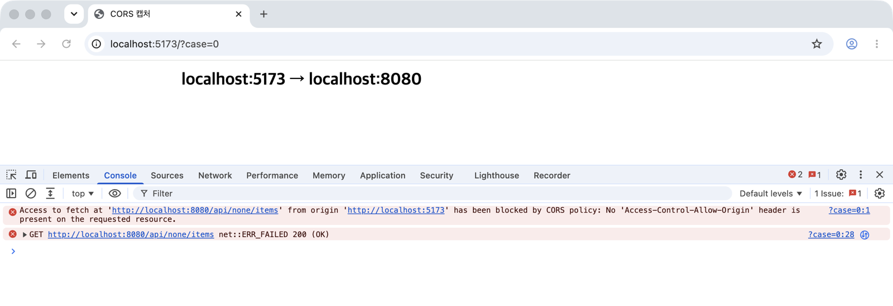
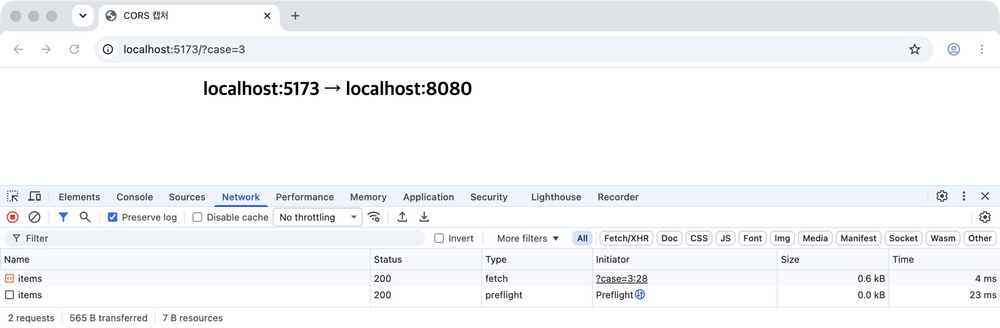
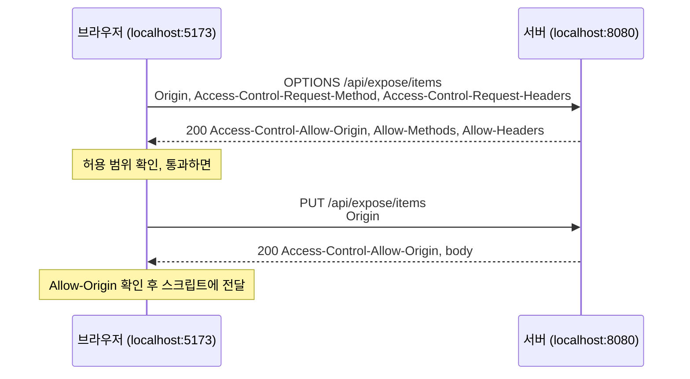
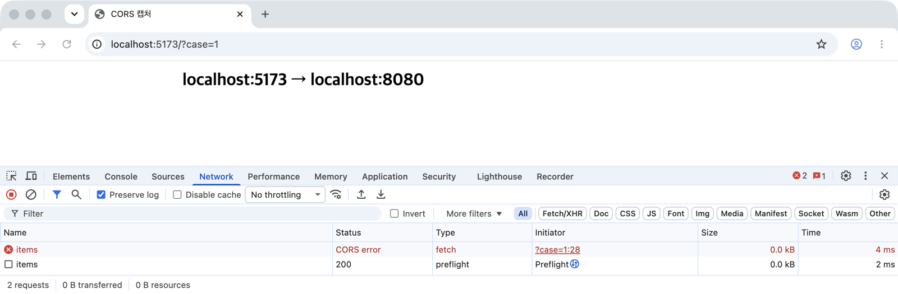
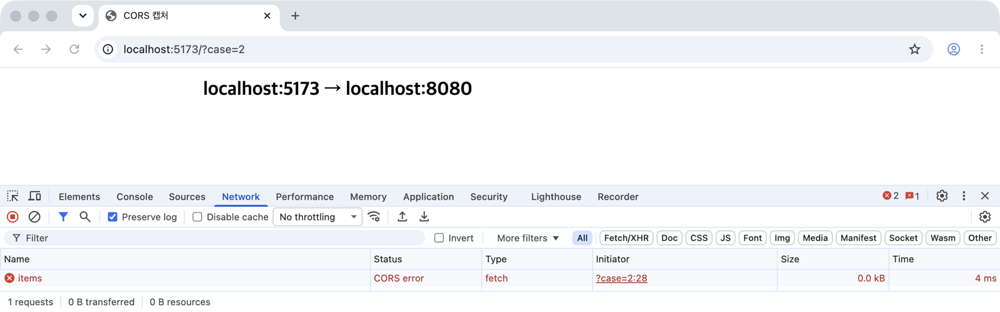
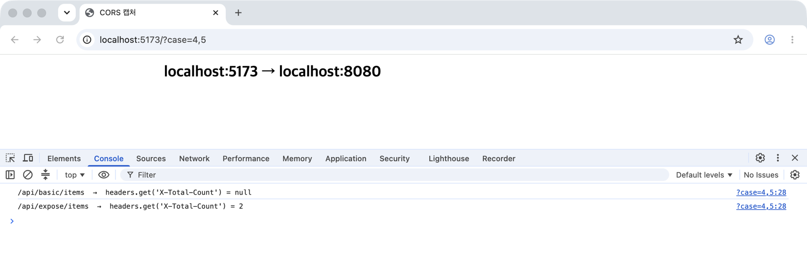
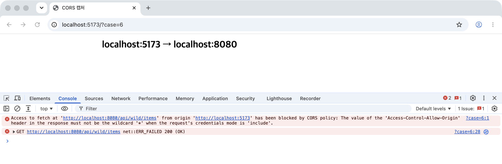
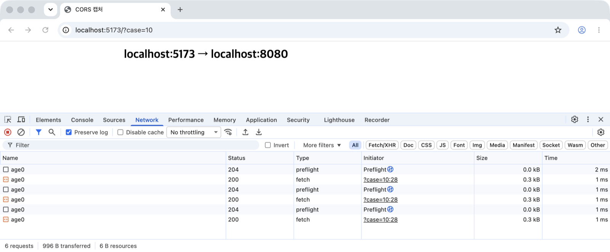
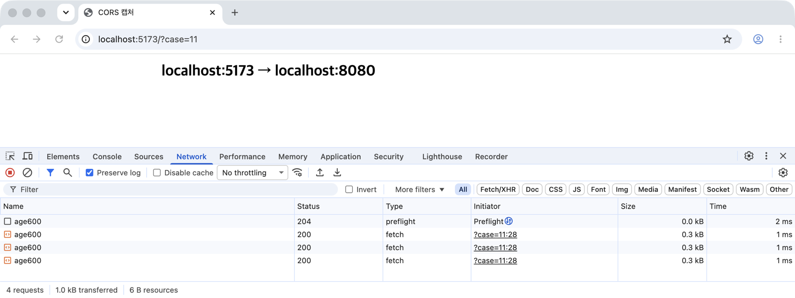
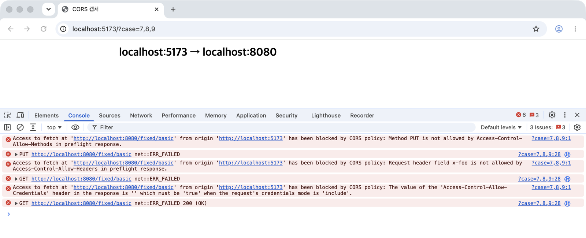

:::info
CORS 에러가 나면 서버에 Access-Control-Allow-Origin 하나를 추가해서 넘어가는 경우가 많은데, 그러다 보면 왜 되는지, 왜 또 안 되는지 매번 헷갈리게 된다. <br />
여기에서는 SOP에서 출발해서 CORS가 어떻게 동작하는지, 브라우저와 서버가 주고받는 헤더가 각각 무슨 뜻인지, 에러 메시지만 보고 원인을 찾는 방법을 정리한다. <br />
예제는 8080 포트에 Spring Boot 4.1.2 서버를, 5173 포트에 프론트 페이지를 따로 띄우고, Chrome 155에서 직접 요청을 보내 확인했다.
:::

---

## 시작은 Same-Origin Policy(SOP)

CORS를 이해하려면 먼저 브라우저가 기본으로 지키는 SOP(동일 출처 정책)를 알아야 한다. <br />
SOP는 <b>"한 출처(Origin)에서 불러온 스크립트는 다른 출처의 자원을 마음대로 읽을 수 없다"</b>는 브라우저의 규칙이다.

### Origin은 scheme + host + port

Origin은 URL에서 <BlueText>scheme, host, port 세 가지</BlueText>를 묶은 것이고, 셋 중 하나라도 다르면 다른 출처가 된다.

`https://eottabom.github.io` 기준으로 비교해보면 아래와 같다.

| URL | 같은 출처? | 이유 |
| --- | --- | --- |
| `https://eottabom.github.io/posts` | O | 경로(path)는 Origin에 포함되지 않는다 |
| `http://eottabom.github.io` | X | scheme이 다르다 (https, http) |
| `https://api.eottabom.github.io` | X | host가 다르다 (서브도메인도 다른 host) |
| `https://eottabom.github.io:8443` | X | port가 다르다 (https 기본 포트는 443) |

로컬 개발에서 프론트를 `localhost:5173`, API를 `localhost:8080`으로 띄우면 host가 같아도 port가 달라서 다른 출처가 되고, 그래서 CORS 에러를 처음 만나게 된다.

### SOP가 막는 것과 막지 않는 것

SOP는 다른 출처로 <b>요청을 보내는 것</b>을 막는 게 아니라, 스크립트가 <b>응답을 읽는 것</b>을 막는다.

| 구분 | 예시 |
| --- | --- |
| 막는 것 | `fetch`, `XMLHttpRequest`로 받은 다른 출처 응답 본문, 헤더 읽기 / 다른 출처 iframe의 DOM 접근 |
| 막지 않는 것 | ``, `<script>`, `<link>`로 다른 출처 자원 불러오기 / `<form>` 전송 / 링크 이동 |

이미지나 스크립트를 CDN에서 불러오는 게 아무 문제 없이 되는 이유가 이것인데, 화면에 그리거나 실행하는 것은 허용하고 그 내용을 스크립트가 꺼내 읽는 것만 막는 것이다.

### 왜 이런 규칙이 필요할까?

브라우저는 요청을 보낼 때 그 사이트의 쿠키를 자동으로 붙인다. <br />
SOP가 없다면 악성 페이지를 여는 순간, 그 페이지의 스크립트가 사용자의 쿠키가 붙은 채로 은행이나 메일 API를 호출하고 그 응답(계좌 내역, 메일 본문)을 읽어갈 수 있다. <br />
SOP는 <RedText>로그인된 사용자의 브라우저를 빌려서 다른 사이트의 데이터를 읽어가는 것</RedText>을 막기 위한 규칙이다.

---

## CORS는 무엇일까?

그런데 프론트와 API를 다른 도메인으로 나누는 구조가 흔해지면서, 다른 출처의 응답을 읽어야 하는 정상적인 경우도 많아졌다. <br />
CORS(Cross-Origin Resource Sharing)는 이럴 때 <b>서버가 "이 출처는 내 응답을 읽어도 된다"고 헤더로 알려주면, 브라우저가 SOP를 예외적으로 풀어주는</b> 방식이다.

즉, CORS는 무언가를 막는 장치가 아니라 SOP로 막혀 있는 것을 <BlueText>허용하는 장치</BlueText>이고, 아래 두 가지만 기억하면 대부분의 동작이 설명된다.

- 허용할지 판단하고 막는 것은 <b>브라우저</b>다. 서버는 응답 헤더로 신호만 보낸다.
- 브라우저가 없으면 CORS도 없다. 서버 간 통신, curl, Postman에는 CORS가 적용되지 않는다.

### 서버는 이미 응답했는데 브라우저가 막는다

CORS 설정이 없는 `/api/none/items`를 `localhost:5173`에서 호출하면, 브라우저 콘솔에는 에러가 찍히고 `fetch`는 `TypeError: Failed to fetch`로 실패한다.

<div style={{ textAlign: 'center' }}>
  
</div>

콘솔 두 번째 줄을 보면 `net::ERR_FAILED` 옆에 `200 (OK)`가 같이 찍혀 있다. <br />
같은 시점의 서버 로그를 봐도, 요청은 컨트롤러까지 정상적으로 들어와서 200으로 응답했다.

```text
HANDLER GET /api/none/items origin=http://localhost:5173
ARRIVED GET /api/none/items origin=http://localhost:5173 status=200
```

서버는 할 일을 다 했고, 응답도 브라우저까지 도착했다. <br />
브라우저가 응답에 `Access-Control-Allow-Origin` 헤더가 없는 것을 보고 <RedText>스크립트에 응답을 넘겨주지 않은 것</RedText>이다. <br />
그래서 CORS 에러는 서버 로그에는 아무 흔적이 없는 경우가 많고, 원인은 항상 응답 헤더에서 찾아야 한다.

---

## CORS 헤더는 요청 헤더와 응답 헤더로 나뉜다

CORS에 쓰이는 헤더는 누가 붙이느냐에 따라 두 종류로 나뉘는데, <b>요청 헤더는 브라우저가 자동으로 붙이고, 응답 헤더는 서버가 붙인다.</b>

### Request Header - 브라우저가 붙인다

| 헤더 | 언제 | 의미 |
| --- | --- | --- |
| Origin | 모든 cross-origin 요청 | 이 요청을 보낸 페이지의 출처 |
| Access-Control-Request-Method | preflight(OPTIONS) | 본 요청에서 쓸 메서드 |
| Access-Control-Request-Headers | preflight(OPTIONS) | 본 요청에 붙일 헤더 목록 |

이 헤더들은 개발자가 `fetch` 옵션에 직접 넣는 게 아니라, 브라우저가 상황을 보고 알아서 붙인다. <br />
서버 입장에서는 이 헤더를 보고 "누가, 어떤 메서드와 헤더로 요청하려 하는지"를 알 수 있고, 그에 맞춰 응답 헤더를 정한다.

### Response Header - 서버가 붙인다

응답 헤더는 <BlueText>preflight 응답에 쓰이는 것</BlueText>과 <BlueText>본 요청 응답에 쓰이는 것</BlueText>으로 나눠 보면 정리가 쉽다.

| 헤더 | 단계 | 의미 |
| --- | --- | --- |
| Access-Control-Allow-Origin | preflight, 본 요청 | 이 응답을 읽어도 되는 출처 (하나 또는 `*`) |
| Access-Control-Allow-Credentials | preflight, 본 요청 | 쿠키, Authorization 같은 인증 정보가 붙은 요청을 허용하는지 |
| Access-Control-Allow-Methods | preflight | 본 요청에 허용하는 메서드 |
| Access-Control-Allow-Headers | preflight | 본 요청에 허용하는 요청 헤더 |
| Access-Control-Max-Age | preflight | preflight 결과를 캐시해도 되는 시간(초) |
| Access-Control-Expose-Headers | 본 요청 | 스크립트가 읽을 수 있게 열어줄 응답 헤더 |
| Vary: Origin | preflight, 본 요청 | 출처에 따라 응답이 달라진다는 캐시용 신호 (CORS 전용 헤더는 아니다) |

요청 헤더와 응답 헤더는 짝을 이룬다. <br />
브라우저가 Access-Control-Request-Method로 "PUT을 쓰고 싶다"고 물으면 서버는 Access-Control-Allow-Methods로 답하고, <br />
Access-Control-Request-Headers로 물은 헤더는 Access-Control-Allow-Headers로 답하는 식이다.

---

## 요청은 Simple Request와 Preflight 두 가지로 나뉜다

브라우저는 cross-origin 요청을 보내기 전에 이 요청이 "단순한 요청"인지 먼저 판단한다.

### Simple Request

아래 조건을 <b>모두</b> 만족하면 Simple Request이고, preflight 없이 본 요청을 바로 보낸다.

- 메서드가 `GET`, `HEAD`, `POST` 중 하나
- 직접 붙인 헤더가 CORS-safelisted 헤더(`Accept`, `Accept-Language`, `Content-Language`, `Content-Type`, `Range`)뿐
- `Content-Type`이 `application/x-www-form-urlencoded`, `multipart/form-data`, `text/plain` 중 하나

조건이 이렇게 정해진 이유는, 이 범위의 요청은 CORS가 생기기 전부터 `<form>` 전송으로 얼마든지 보낼 수 있었기 때문이다. <br />
원래 보낼 수 있던 요청이니 미리 물어보지 않고 보내되, 응답을 읽을지만 CORS 헤더로 판단한다.

:::note
<b>safelist란?</b>
Fetch 명세가 "CORS가 따로 허락을 요구하지 않아도 되는 헤더"로 정해둔 목록이다. 요청 쪽과 응답 쪽에 하나씩 있다. <br />
요청 쪽(CORS-safelisted request header)은 스크립트가 직접 붙여도 preflight를 일으키지 않는 헤더. (Accept, Accept-Language, Content-Language, Content-Type, Range) <br />
form이나 img로도 이미 보낼 수 있던 헤더라서 새 위험이 없다고 보는 것이고, 그래서 Content-Type도 form이 보낼 수 있는 세 가지 값일 때만 safelist로 인정된다. <br />
:::

### Preflighted Request

위 조건 중 하나라도 벗어나면 브라우저는 본 요청 전에 `OPTIONS` 메서드로 <b>"이렇게 보내도 되는지"</b>를 먼저 물어보는데, 이것이 preflight다. <br />
`Content-Type: application/json`, `PUT`/`DELETE`/`PATCH`, safelist에 없는 헤더(`Authorization`, `X-Request-Id` 등) 중 하나만 써도 preflight가 발생한다. <br />
`Authorization`은 표준 헤더지만 safelist에는 없어서, 토큰을 붙이는 순간 preflight 대상이 된다.

preflight는 브라우저가 알아서 보내는 요청이라, 프론트 코드에서 `OPTIONS`를 직접 호출할 일은 없다.

### Preflight 요청과 응답 살펴보기

브라우저가 보내는 preflight를 curl로 똑같이 만들어서 Spring 서버에 보내보면 아래와 같다. <br />
`PUT` 메서드에 `Content-Type`, `X-Request-Id` 헤더를 붙이겠다고 묻는 요청이다.

```bash
curl -i -X OPTIONS http://localhost:8080/api/expose/items \
  -H 'Origin: http://localhost:5173' \
  -H 'Access-Control-Request-Method: PUT' \
  -H 'Access-Control-Request-Headers: content-type,x-request-id'
```

```text
HTTP/1.1 200
Vary: Origin
Vary: Access-Control-Request-Method
Vary: Access-Control-Request-Headers
Access-Control-Allow-Origin: http://localhost:5173
Access-Control-Allow-Methods: GET,POST,PUT
Access-Control-Allow-Headers: content-type, x-request-id
Access-Control-Expose-Headers: X-Total-Count
Access-Control-Allow-Credentials: true
Access-Control-Max-Age: 1800
```

브라우저는 이 응답을 보고 출처, 메서드, 헤더가 모두 허용되었는지 확인한 뒤에야 본 요청(`PUT`)을 보낸다. <br />
실제로 브라우저에서 같은 요청을 보내보면, Network 탭에 Type이 `preflight`인 OPTIONS와 본 요청(`fetch`)이 따로 찍힌다.

<div style={{ textAlign: 'center' }}>
  
</div>

흐름을 정리하면 아래와 같다.



### Preflight가 실패하면 본 요청은 아예 가지 않는다

CORS 설정이 없는 같은 엔드포인트에 `Content-Type`만 바꿔서 `POST`를 두 번 보내보면 차이가 분명하게 보인다.

```javascript
// 1) application/json → preflight 대상
fetch('http://localhost:8080/api/none/items', {
  method: 'POST',
  headers: { 'Content-Type': 'application/json' },
  body: '1',
});

// 2) text/plain → Simple Request
fetch('http://localhost:8080/api/none/items', {
  method: 'POST',
  headers: { 'Content-Type': 'text/plain' },
  body: 'hello',
});
```

두 요청 모두 브라우저에서는 CORS 에러로 실패하는데, 서버 로그는 아래와 같이 다르다.

```text
# 1) application/json
ARRIVED OPTIONS /api/none/items origin=http://localhost:5173 status=200

# 2) text/plain
HANDLER POST /api/none/items origin=http://localhost:5173 body=hello
ARRIVED POST /api/none/items origin=http://localhost:5173 status=200
```

Network 탭에서 보면 차이가 더 분명한데, `application/json`은 preflight만 200으로 다녀오고 본 요청은 `CORS error`로 끝났다.

<div style={{ textAlign: 'center' }}>
  
</div>

`text/plain`은 preflight 없이 본 요청 한 줄만 찍혔다.

<div style={{ textAlign: 'center' }}>
  
</div>

`application/json`은 preflight 응답에 CORS 헤더가 없어서 <b>본 요청(POST)이 서버에 도착하지도 않았다.</b> <br />
반면 `text/plain`은 Simple Request라서 본 요청이 바로 갔고, <RedText>컨트롤러가 실행되어 body까지 처리한 뒤</RedText>에 브라우저가 응답만 막았다.

:::warning
Simple Request는 CORS 에러가 나도 서버에서는 이미 실행된다. 
그래서 데이터를 바꾸는 API를 CORS만 믿고 열어두면 안 되고, 인증과 CSRF 방어는 서버가 따로 해야 한다.
:::

---

## Spring에서 CORS 설정하기

Spring MVC에서는 `WebMvcConfigurer`의 `addCorsMappings`로 경로별 CORS 정책을 정할 수 있다. <br />
위 실험에서 쓴 설정은 아래와 같다.

```java
@Configuration
public class CorsConfig implements WebMvcConfigurer {

	@Override
	public void addCorsMappings(CorsRegistry registry) {
		registry.addMapping("/api/expose/**")
				.allowedOrigins("http://localhost:5173")
				.allowedMethods("GET", "POST", "PUT")
				.allowedHeaders("Content-Type", "X-Request-Id")
				.exposedHeaders("X-Total-Count")
				.allowCredentials(true)
				.maxAge(1800);
	}
}
```

| 메서드 | 응답 헤더 | 지정하지 않았을 때 |
| --- | --- | --- |
| allowedOrigins | Access-Control-Allow-Origin | 모든 출처(`*`) |
| allowedMethods | Access-Control-Allow-Methods | GET, HEAD, POST |
| allowedHeaders | Access-Control-Allow-Headers | 모든 헤더 |
| exposedHeaders | Access-Control-Expose-Headers | 없음 |
| allowCredentials | Access-Control-Allow-Credentials | 붙이지 않음 |
| maxAge | Access-Control-Max-Age | 1800초 |

### Spring은 허용하지 않은 요청을 403으로 거절한다

Spring은 헤더만 붙이고 끝나는 게 아니라, 허용 범위를 벗어난 요청은 직접 거절한다. <br />
허용하지 않은 출처로 `GET`을 보내거나, 허용하지 않은 헤더로 preflight를 보내면 아래처럼 CORS 헤더 없이 403이 돌아오고 컨트롤러는 실행되지 않는다.

```bash
curl -i http://localhost:8080/api/basic/items -H 'Origin: http://evil.example'
```

```text
HTTP/1.1 403
Vary: Origin
Vary: Access-Control-Request-Method
Vary: Access-Control-Request-Headers

Invalid CORS request
```

이 동작 때문에 Spring 서버에서는 원인이 메서드든 헤더든, 브라우저 콘솔에는 대부분 <BlueText>"No 'Access-Control-Allow-Origin' header is present"</BlueText>로 찍힌다. <br />
예를 들어 허용하지 않은 `PUT`을 보내도 Chrome에는 아래처럼 찍힌다.

```text
Access to fetch at 'http://localhost:8080/api/basic/items' from origin 'http://localhost:5173'
has been blocked by CORS policy: Response to preflight request doesn't pass access control check:
No 'Access-Control-Allow-Origin' header is present on the requested resource.
```

그래서 Spring에서 이 메시지가 보이면 출처만 볼 게 아니라, 요청의 메서드와 헤더가 `allowedMethods`, `allowedHeaders`에 들어 있는지도 같이 확인해야 한다.

:::note
Origin 헤더가 없는 요청(curl, 서버 간 호출)은 CORS 요청이 아니라서, Spring은 CORS 검사를 하지 않고 그대로 처리한다. 
허용하지 않은 출처를 403으로 막는 것도 결국 브라우저가 Origin을 붙여줄 때만 의미가 있다.
:::

### Spring Security를 쓰면 http.cors()를 켜야 한다

`addCorsMappings`를 설정했는데도 배포하고 나서 preflight가 막히는 경우가 많은데, 대부분 Spring Security 때문이다. <br />
`addCorsMappings` 설정은 Spring MVC의 HandlerMapping 단계에서 처리되는데, Security 필터 체인은 그보다 앞에서 동작한다. <br />
그래서 preflight(OPTIONS)는 인증 정보 없이 오는 요청이라, Security가 MVC까지 가기도 전에 401로 돌려보낸다.

모든 요청에 인증을 요구하는 `SecurityFilterChain`을 두고, `Authorization` 헤더를 붙인 요청을 `localhost:5173`에서 보내보면 아래와 같다.

```java
@Bean
SecurityFilterChain filterChain(HttpSecurity http) throws Exception {
	http.authorizeHttpRequests(auth -> auth.anyRequest().authenticated())
			.httpBasic(Customizer.withDefaults())
			.cors(Customizer.withDefaults()); // 이 줄이 없으면 preflight 가 401
	return http.build();
}
```

| http.cors() | preflight 응답 | 결과 |
| --- | --- | --- |
| 없음 | 401, WWW-Authenticate만 있고 CORS 헤더 없음 | 본 요청 안 감, No 'Access-Control-Allow-Origin' 에러 |
| cors(Customizer.withDefaults()) | 200, Access-Control-Allow-Origin, Allow-Headers: authorization | 본 요청 200 |

`http.cors(Customizer.withDefaults())`를 켜면 Security가 필터 단계에서 CORS를 먼저 처리하는데, 별도의 `CorsConfigurationSource` 빈이 없으면 `addCorsMappings`에 적어둔 설정을 그대로 가져다 쓴다. <br />
`http.cors()`가 없을 때는 요청을 기록하는 필터에도 OPTIONS가 찍히지 않았는데, Security 필터에서 이미 끝난 요청이기 때문이다.

---

## 자주 놓치는 디테일

### 1) 응답 헤더가 있는데 프론트에서 null이 나온다 (Expose-Headers)

서버가 `X-Total-Count` 헤더를 내려주는데 프론트에서 `response.headers.get('X-Total-Count')`가 `null`로 나오는 경우가 있다. <br />
CORS 응답에서 스크립트가 읽을 수 있는 헤더는 기본으로 정해져 있고, 나머지는 Access-Control-Expose-Headers로 열어줘야 한다.

같은 헤더를 내려주는 두 엔드포인트를 호출해보면 아래와 같다.

| 엔드포인트 | Expose-Headers | status | X-Total-Count | Content-Type |
| --- | --- | --- | --- | --- |
| /api/basic/items | 없음 | 200 | null | application/json |
| /api/expose/items | X-Total-Count | 200 | 2 | application/json |

<div style={{ textAlign: 'center' }}>
  
</div>

요청은 성공했고 콘솔에도 에러가 없어서 원인을 찾기가 더 어려운 경우인데, `Content-Type`은 읽히고 `X-Total-Count`만 `null`인 이유는 `Content-Type`이 기본으로 열려 있는 헤더이기 때문이다.

기본으로 읽을 수 있는 헤더(CORS-safelisted response header)는 아래 7개다.

- `Cache-Control`, `Content-Language`, `Content-Length`, `Content-Type`, `Expires`, `Last-Modified`, `Pragma`

페이지네이션 총 개수, `Location`, 요청 추적 ID처럼 프론트가 읽어야 하는 커스텀 헤더는 `exposedHeaders`에 꼭 넣어야 한다.

### 2) Allow-Origin: * 와 credentials는 같이 쓸 수 없다

쿠키를 같이 보내려면 프론트에서 `credentials: 'include'`를 쓰는데, 이때 응답의 Access-Control-Allow-Origin이 `*`이면 Chrome은 아래와 같이 막는다.

<div style={{ textAlign: 'center' }}>
  
</div>

"아무 출처나"와 "사용자 쿠키를 붙여서"를 동시에 허용하면 SOP를 아예 끄는 것과 같기 때문에, 인증 정보가 붙은 요청에는 출처를 정확히 하나 적어야 한다. <br />
반대로 Access-Control-Allow-Origin은 맞는데 Access-Control-Allow-Credentials: true가 빠져도 아래와 같이 막힌다.

```text
... has been blocked by CORS policy: The value of the 'Access-Control-Allow-Credentials' header
in the response is '' which must be 'true' when the request's credentials mode is 'include'.
```

Spring도 이 조합을 허용하지 않는데, `allowedOrigins("*")`와 `allowCredentials(true)`를 같이 쓰면 애플리케이션은 뜨지만  <br />
CORS 요청이 들어올 때 예외와 함께 500이 난다.

```text
java.lang.IllegalArgumentException: When allowCredentials is true, allowedOrigins cannot contain
the special value "*" since that cannot be set on the "Access-Control-Allow-Origin" response header.
To allow credentials to a set of origins, list them explicitly or consider using "allowedOriginPatterns" instead.
```

예외 메시지가 권하는 `allowedOriginPatterns`는 `https://*.example.com`처럼 패턴으로 출처를 지정하는 기능이다. <br />
그런데 여기에 `"*"`를 넣으면 요청한 출처를 그대로 Access-Control-Allow-Origin에 돌려준다.

```text
# allowedOriginPatterns("*") + allowCredentials(true), Origin: http://anything.example
Access-Control-Allow-Origin: http://anything.example
Access-Control-Allow-Credentials: true
```

브라우저 검사는 통과하지만 결과적으로 <RedText>모든 출처에 쿠키를 붙인 요청을 허용</RedText>하는 셈이라, 에러를 없애려고 이렇게 바꾸는 것은 피해야 한다.

### 3) credentials가 있으면 Allow-Methods, Allow-Headers의 *도 동작하지 않는다

Access-Control-Allow-Methods와 Access-Control-Allow-Headers에도 `*`를 쓸 수 있는데, 이 `*`는 credentials가 없는 요청에서만 와일드카드로 동작한다. <br />
credentials가 있는 요청에서는 `*`가 그냥 `*`라는 이름으로 취급된다.

Nginx처럼 고정된 헤더를 내려주도록 만든 엔드포인트에서 확인해보면 아래와 같다.

| 응답 헤더 | 요청 | 결과 |
| --- | --- | --- |
| Allow-Methods: *, Allow-Headers: * | PUT + X-Foo, credentials 없음 | 성공 |
| 위와 같음 + Allow-Credentials: true | PUT, credentials: include | Method PUT is not allowed by Access-Control-Allow-Methods |
| 위와 같음 + Allow-Credentials: true | POST + X-Foo, credentials: include | Request header field x-foo is not allowed by Access-Control-Allow-Headers |

쿠키나 인증 헤더를 쓰는 API라면 메서드와 헤더도 목록으로 명시해야 한다.

`Authorization` 헤더는 credentials가 없어도 따로 봐야 한다. <br />
Fetch 명세는 Access-Control-Allow-Headers의 `*`가 `Authorization`을 포함하지 않는다고 정해두었는데, credentials 없이 `Authorization: Bearer ...`를 붙여 `Allow-Headers: *` 엔드포인트를 호출해보면 브라우저마다 아래와 같이 다르게 동작했다.

| 브라우저 | 결과 |
| --- | --- |
| Chrome 155 | 성공, 콘솔에는 아무것도 없지만 DevTools Issues 탭에 지원 중단 경고(AuthorizationCoveredByWildcard) |
| Firefox 157 | 성공했지만 "Authorization 헤더는 * 에 포함되지 않으니 곧 막힐 것"이라는 경고 출력 |

지금은 통과하더라도 명세상으로는 막혀야 하는 요청이고, 두 브라우저 모두 앞으로 막겠다고 경고하고 있다. <br />
`Authorization`을 쓰는 API라면 Allow-Headers에 `Authorization`을 명시적으로 넣어두는 것이 안전하다.

### 4) Vary: Origin 이 없으면 캐시가 다른 출처의 응답을 돌려줄 수 있다

허용 출처가 여러 개면 서버는 요청의 Origin을 보고 Access-Control-Allow-Origin 값을 그때그때 바꿔서 내려준다. <br />
그런데 중간의 CDN이나 프록시 캐시는 기본적으로 URL만 보고 응답을 캐시하기 때문에, `a.example.com`에 대한 응답(`Access-Control-Allow-Origin: https://a.example.com`)이 캐시되면 `b.example.com`의 요청에도 그 응답이 나가서 CORS 에러가 나거나, 반대로 허용하면 안 되는 출처에 허용 응답이 나갈 수 있다.

Vary: Origin은 캐시에 <b>"이 응답은 Origin 값마다 따로 캐시하라"</b>고 알려주는 헤더다. <br />
preflight 응답도 마찬가지인데, 한 출처에 대한 preflight 응답이 캐시되어 다른 출처에 나가면 그 출처의 preflight가 깨진다. <br />
Spring은 위 curl 결과처럼 preflight와 본 요청 응답 모두에 Vary: Origin, Access-Control-Request-Method, Access-Control-Request-Headers를 자동으로 붙여주는데, Nginx나 게이트웨이에서 헤더를 직접 붙이는 경우에는 빠뜨리기 쉬우니 같이 넣어야 한다.

### 5) Max-Age가 짧으면 요청마다 OPTIONS가 한 번 더 나간다

preflight는 본 요청 앞에 왕복이 한 번 더 붙는 것이라, 매번 나가면 지연과 트래픽이 그만큼 늘어난다. <br />
Access-Control-Max-Age는 preflight 결과를 브라우저가 캐시하는 시간(초)인데, 같은 `application/json` POST를 세 번씩 보내고 서버에 도착한 OPTIONS를 세어보면 아래와 같다.

| Max-Age | 연달아 POST 3번 | 서버에 도착한 OPTIONS |
| --- | --- | --- |
| 0 | POST 3번 | 3번 (매번 preflight) |
| 600 | POST 3번 | 1번 |
| 헤더 없음 | POST 3번 | 1번, 6초 뒤 다시 보내면 OPTIONS 1번 더 |

Network 탭에서 보면 Max-Age가 0일 때는 요청마다 preflight가 붙고,

<div style={{ textAlign: 'center' }}>
  
</div>

600일 때는 첫 요청에만 preflight가 붙고 나머지 두 번은 본 요청만 나간다.

<div style={{ textAlign: 'center' }}>
  
</div>

헤더가 없을 때 짧게 캐시되었다가 6초 뒤에 다시 preflight가 나간 것은, Max-Age가 없으면 기본값 5초가 적용되기 때문이다. <br />
값을 크게 줘도 브라우저마다 상한이 있어서 MDN 기준으로 Chromium은 2시간(7200초), Firefox는 24시간(86400초)까지만 캐시한다.

:::tip
Spring의 기본 maxAge는 1800초(30분)라서 따로 건드리지 않아도 preflight가 매번 나가지는 않는다. 
Nginx나 게이트웨이에서 직접 헤더를 붙일 때 Max-Age를 빠뜨리지 않았는지 확인해보자.
:::

---

## 에러 메시지로 원인 찾기

Chrome의 CORS 에러 메시지는 형식이 정해져 있어서, 메시지만 보고 어느 헤더를 봐야 하는지 바로 알 수 있다. <br />
이번 실험에서 실제로 찍힌 메시지를 정리하면 아래와 같다.

<div style={{ textAlign: 'center' }}>
  
</div>

| 메시지 | 원인 | 확인할 곳 |
| --- | --- | --- |
| No 'Access-Control-Allow-Origin' header is present on the requested resource. | 응답에 Allow-Origin이 없다 | 출처 허용 목록, 서버가 CORS 설정 전에 에러를 냈는지 |
| Response to preflight request doesn't pass access control check: No 'Access-Control-Allow-Origin' ... | preflight 응답에 Allow-Origin이 없다 | OPTIONS 처리, Spring이면 메서드와 헤더 허용 목록까지 |
| Method PUT is not allowed by Access-Control-Allow-Methods in preflight response. | 메서드가 허용 목록에 없다 | Allow-Methods |
| Request header field x-foo is not allowed by Access-Control-Allow-Headers in preflight response. | 요청 헤더가 허용 목록에 없다 | Allow-Headers |
| ... must not be the wildcard '*' when the request's credentials mode is 'include'. | `*`와 credentials를 같이 썼다 | Allow-Origin을 출처 하나로 |
| The value of the 'Access-Control-Allow-Credentials' header in the response is '' which must be 'true' ... | credentials 요청인데 Allow-Credentials가 없다 | Allow-Credentials: true |
| (에러 없음) 응답 헤더가 null | Expose-Headers에 없다 | Expose-Headers |

Method, Request header field 메시지는 Nginx나 게이트웨이처럼 CORS 헤더를 고정값으로 내려주는 환경에서 주로 보인다. <br />
Spring은 허용 범위를 벗어난 preflight를 CORS 헤더 없이 403으로 거절하기 때문에, 같은 원인이어도 No 'Access-Control-Allow-Origin' 메시지로 나타난다. <br />
Spring Security에서 `http.cors()`를 켜지 않아 preflight가 401로 막힌 경우도 같은 메시지로 나타난다.

어떤 경우든 `fetch` 쪽에서는 `TypeError: Failed to fetch`만 받기 때문에, 원인은 항상 콘솔 메시지와 Network 탭의 응답 헤더에서 찾아야 한다.

---

## CORS가 아닌 것

CORS를 보안 기능으로 오해하면 설정을 잘못 판단하게 되는데, 자주 헷갈리는 것을 정리하면 아래와 같다.

| 오해 | 실제 |
| --- | --- |
| CORS를 설정하면 API가 보호된다 | CORS는 브라우저의 응답 읽기만 제어한다. curl이나 서버에서 부르면 CORS 검사 자체가 없다 |
| CORS 에러가 나면 서버에서 처리되지 않았다 | Simple Request는 서버에서 이미 실행된 뒤에 브라우저가 응답만 막는다 |
| CORS를 통과하면 인증된 요청이다 | 출처 허용과 사용자 인증/인가는 별개다. 서버는 여전히 직접 인증해야 한다 |
| CORS와 CSRF는 같은 문제다 | CSRF는 "응답을 읽지 않아도 요청만 보내면 되는" 공격이라, Simple Request로 그대로 가능하다.  <br /> CSRF 토큰, SameSite 쿠키로 막아야 한다 |
| API 서버만 있으면 CORS는 신경 쓸 필요 없다 | 브라우저에서 직접 호출하는 한 필요하다. 서버 간 호출만 있다면 필요 없다 |

---

## 정리

:::success
<b>요약</b>
✔ SOP는 다른 출처로 요청을 보내는 게 아니라 응답을 읽는 것을 막고, CORS는 서버가 헤더로 허락하면 브라우저가 그 제한을 풀어주는 장치다<br />
✔ 판단하고 막는 것은 브라우저라서, CORS 에러가 나도 Simple Request는 서버에서 이미 실행된다<br />
✔ 요청 헤더(Origin, Access-Control-Request-Method, Access-Control-Request-Headers)는 브라우저가 붙인다<br />
✔ 응답 헤더(Access-Control-Allow 계열, Expose-Headers, Max-Age)는 서버가 붙인다<br />
✔ JSON, PUT/DELETE, safelist에 없는 헤더(Authorization 포함) 중 하나만 써도 preflight(OPTIONS)가 먼저 나가고, 실패하면 본 요청은 가지 않는다<br />
✔ credentials를 쓰면 와일드카드(*)는 Allow-Origin, Allow-Methods, Allow-Headers 어디에서도 동작하지 않는다<br />
✔ Spring Security를 쓴다면 http.cors()를 켜야 preflight가 인증 필터에 막히지 않는다
:::

헤더를 하나하나 외우기보다 <b>"preflight에서 묻고 답하는 헤더"</b>와 <b>"본 요청 응답에서 읽기를 허락하는 헤더"</b>로 묶어서 보면 훨씬 덜 헷갈린다. <br />
CORS 에러가 나면 서버 로그보다 콘솔 메시지를 먼저 보고, 위 표에서 어느 헤더가 빠졌는지 찾아서 서버 설정을 그 헤더 하나만 고치는 것이 가장 빠르다.

---

## 📚 Reference

* [MDN - Cross-Origin Resource Sharing (CORS)](https://developer.mozilla.org/docs/Web/HTTP/CORS)
* [MDN - Same-origin policy](https://developer.mozilla.org/docs/Web/Security/Same-origin_policy)
* [MDN - Access-Control-Max-Age](https://developer.mozilla.org/docs/Web/HTTP/Headers/Access-Control-Max-Age)
* [MDN - CORS-safelisted response header](https://developer.mozilla.org/docs/Glossary/CORS-safelisted_response_header)
* [Fetch Standard - CORS protocol](https://fetch.spec.whatwg.org/#http-cors-protocol)
* [RFC 6454 - The Web Origin Concept](https://datatracker.ietf.org/doc/html/rfc6454)
* [Spring Framework - CORS](https://docs.spring.io/spring-framework/reference/web/webmvc-cors.html)
* [Spring Security - CORS](https://docs.spring.io/spring-security/reference/servlet/integrations/cors.html)
* [let-me-code - cors](https://github.com/eottabom/let-me-code/tree/main/cors)
