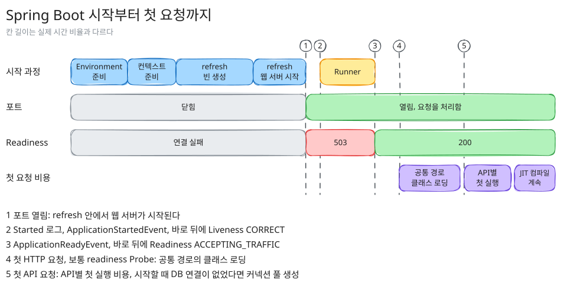
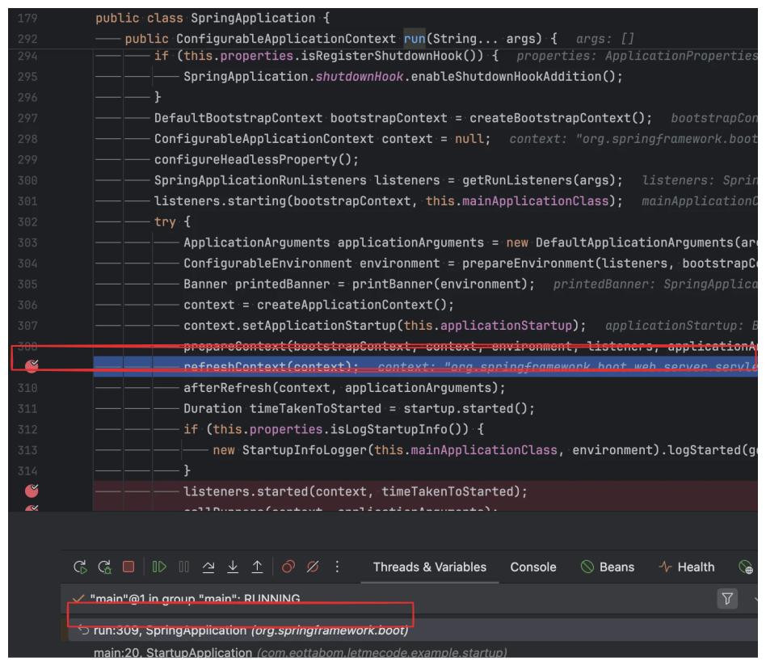
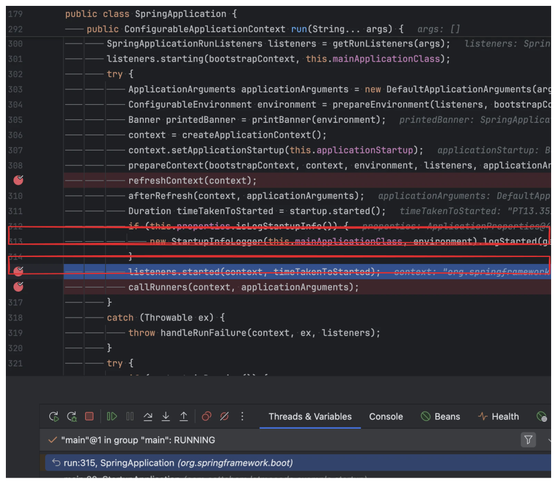
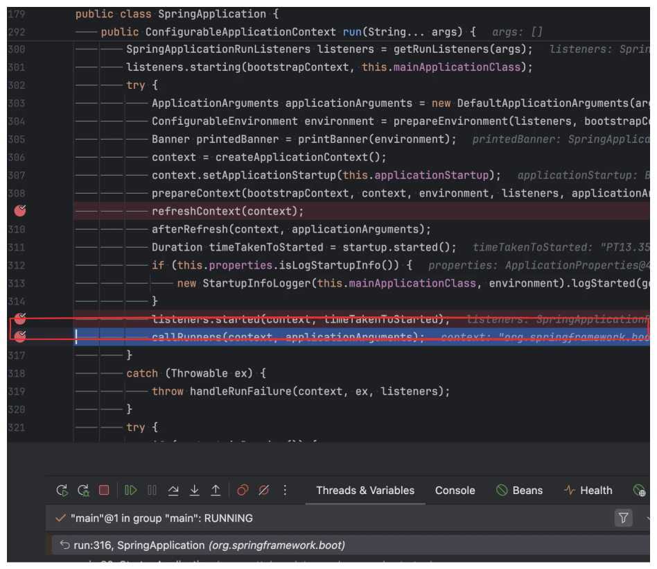
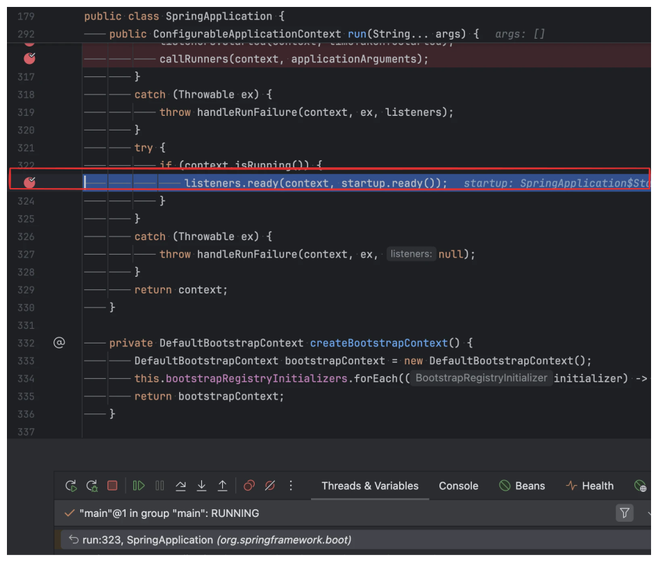
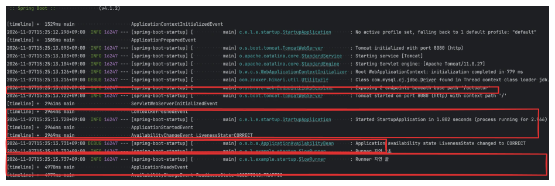
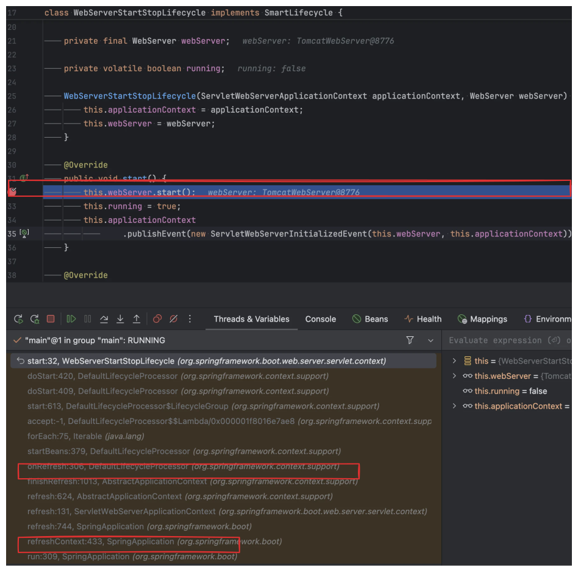

:::info
새로 배포한 서버가 Ready 가 되어 트래픽을 받기 시작했는데, 첫 요청만 유독 느린 경우가 있다. <br />
Spring Boot 4.1 의 시작 과정을 따라가며 Started 와 Ready 의 차이를 정리하고, Ready 뒤에도 첫 요청에 남는 비용을 Spring 과 JVM 관점에서 측정해 보자.
:::

---

## 배포 직후 첫 요청만 느리다?!

애플리케이션을 띄우면 아래와 같이 Started 로그가 찍히고 readiness 도 200 을 응답한다.

```text
Tomcat started on port 8080 (http) with context path '/'
Started StartupApplication in 1.877 seconds (process running for 2.195)

$ curl -s -o /dev/null -w "%{http_code}" localhost:8080/actuator/health/readiness
200
```

그런데 같은 시점에 MySQL 에서 한 건을 조회하는 `/users/1` 을 연달아 호출해보면, 한 번 띄운 결과에서 응답 시간이 아래와 같이 나온다.

| 요청 순번 | 서버 처리 시간 |
| --- | --- |
| 1번째 | <RedText>206.4ms</RedText> |
| 2번째 | 3.6ms |
| 5번째 | 2.0ms |
| 100번째 | 1.5ms |

애플리케이션은 시작을 마쳤고 readiness 도 통과했는데, <b>첫 요청만 100배 넘게 느리다.</b> <br />
Started 로그와 readiness 200 은 정확히 무엇이 끝났다는 뜻이고, 그 뒤에는 무엇이 남아 있을까?

---

## 한눈에 보기

Spring Boot 애플리케이션이 "준비됐다"고 말할 수 있는 시점은 하나가 아닌데, 시작부터 첫 요청까지를 그려보면 아래와 같다.

<figure>
    
</figure>

Liveness, Readiness 는 각 이벤트 바로 뒤에 바뀌는데, 그림의 2번(Started), 3번(Ready), 4번과 5번(첫 요청)을 기준으로 정리하면 아래와 같다.

| 시점 | 바뀌는 상태 | 아직 남은 일 |
| --- | --- | --- |
| **Started** | Liveness CORRECT, Readiness 는 아직 아님 | Runner, 그리고 Ready 뒤에 남는 일 전부 |
| **Ready** | Readiness ACCEPTING_TRAFFIC | 첫 실행 경로의 클래스 로딩, JIT 컴파일, <br /> 설정에 따라 lazy 빈, 커넥션 풀, 아직 HTTP 요청이 없었다면 DispatcherServlet |
| **첫 요청 이후** | 바뀌는 상태 없음 | JIT 컴파일, 요청이 반복되는 동안 계속 |

:::note
<b>한 줄 요약</b>
**Started** 는 컨텍스트가 뜬 시점이고, **Ready** 는 Runner 까지 끝나서 트래픽을 받아도 된다고 알리는 시점이다.
첫 요청이 빠르려면 Ready 뒤에 남은 초기화와 첫 실행 비용까지 치러야 한다.
:::

---

## 테스트 환경

| 항목 | 값 |
| --- | --- |
| JDK | Azul Zulu 25.0.2 |
| 애플리케이션 | Spring Boot 4.1.2 (Spring Framework 7.0.10, Tomcat 11.0.27), Actuator |
| DB | MySQL 8.4 (Docker), HikariCP 7.0.2, Hibernate 7.4.13 |

첫 요청에 어떤 비용이 더해지는지 나눠 보려고, 의존하는 대상이 다른 API 세 개를 두었다.

| API | 하는 일 |
| --- | --- |
| `/hello` | 고정된 JSON 을 돌려준다. DB 나 외부 호출 없이 Spring MVC 만 거친다 |
| `/users/{id}` | JdbcClient 로 MySQL 에서 한 건을 조회한다. 측정은 `/users/1` 로 했다 |
| `/external` | RestClient 로 로컬 스텁 서버를 호출한다 |

테스트는 아래와 같이 나눠서 진행했는데, 테스트마다 애플리케이션을 10번 새로 띄우고 중앙값을 냈다.

| 테스트 | 측정한 값 | 조건 |
| --- | --- | --- |
| 시작 단계 | `/actuator/startup` 의 단계별 소요 시간 | 기본 설정 |
| 이벤트 순서 | 이벤트마다 JVM 시작 기준 발행 시각, Liveness, Readiness 변화 | Runner 2초 |
| 포트와 Ready | 100ms 마다 호출한 `/hello`, liveness, readiness 의 응답 코드 | Runner 5초 |
| DispatcherServlet, lazy 빈 | DispatcherServlet 초기화 시간, <br /> 첫 `/hello` 와 반복 `/hello` 시간 | 기본값, load-on-startup=1, lazy-initialization |
| 커넥션 풀 | 풀이 시작된 시점과 스레드, 첫 `/users/1` 시간 | JDBC, JPA + 기본 설정, JPA + ddl-auto 지정, 메타데이터 조회 끔 |
| 클래스 로딩, JIT | 구간별로 로딩된 클래스 수와 컴파일 수 | readiness 확인 후, readiness 확인 없이 |
| 첫 요청과 반복 요청 | API 별 1번째, 2\~10번째, 11\~200번째 응답 시간 | API 마다 애플리케이션을 새로 띄움 |
| Ready 직후 동시 요청 | 구간별 CPU, 컴파일러 스레드 CPU, 컴파일 수, k6 응답 시간 | Ready 뒤 3초 대기, VU 4개가 10초 동안 호출 |

Spring MVC 기준으로 측정했고, WebFlux 는 요청을 처리하는 경로가 달라서 DispatcherServlet 초기화나 첫 요청에 로딩되는 클래스가 다르게 나타날 수 있다. <br />
응답 시간은 가장 바깥 서블릿 필터에서 요청마다 잰 서버 안의 시간이고, 이 측정용 필터를 처음 실행하는 비용도 함께 들어 있다. <br />
같은 설정이어도 Started 시간이 실행마다 1.6초에서 2.1초 사이로 달라져서 테스트끼리 수치가 조금씩 다른데, 수치는 이 환경에서 흐름을 보기 위한 예시로 읽으면 된다.

:::tip
<a href="https://github.com/eottabom/let-me-code/tree/main/spring-boot-startup">테스트 애플리케이션과 측정 스크립트 보러가기 (클릭)</a>
:::

---

## Spring Boot 시작 과정

### 1) SpringApplication.run() 의 순서

`SpringApplication.run()` 을 열어보면 시작 과정이 아래 순서로 이어진다. (Spring Boot 4.1.2, 일부 생략, [코드 바로가기](https://github.com/spring-projects/spring-boot/blob/v4.1.2/core/spring-boot/src/main/java/org/springframework/boot/SpringApplication.java#L292-L330))

```java
public ConfigurableApplicationContext run(String... args) {
    ...
    listeners.starting(bootstrapContext, this.mainApplicationClass);           // ApplicationStartingEvent
    try {
        ConfigurableEnvironment environment = prepareEnvironment(...);        // ApplicationEnvironmentPreparedEvent
        context = createApplicationContext();
        prepareContext(...);                                                  // ApplicationContextInitializedEvent, ApplicationPreparedEvent
        refreshContext(context);                                              // 빈 생성, 웹 서버 시작
        afterRefresh(context, applicationArguments);
        Duration timeTakenToStarted = startup.started();
        new StartupInfoLogger(...).logStarted(getApplicationLog(), startup);  // "Started ... in N seconds"
        listeners.started(context, timeTakenToStarted);                       // ApplicationStartedEvent, LivenessState.CORRECT
        callRunners(context, applicationArguments);                           // ApplicationRunner, CommandLineRunner
    }
    ...
    if (context.isRunning()) {
        listeners.ready(context, startup.ready());                            // ApplicationReadyEvent, ReadinessState.ACCEPTING_TRAFFIC
    }
    return context;
}
```

IntelliJ 디버거로 refreshContext, listeners.started, callRunners, listeners.ready 줄에 중단점을 걸고 띄워보면 아래 순서로 멈춘다.

<Tabs>
    <Tab label="1. refreshContext">
        * <b>확인해야 하는 부분</b>
          * 여기서 refresh 로 들어가 빈을 만들고, 웹 서버를 띄워 포트를 연다
          * 아직 Started 로그는 찍히지 않았다
        
    </Tab>
    <Tab label="2. listeners.started">
        * <b>확인해야 하는 부분</b>
          * refresh 와 Started 로그(313번 줄)는 이미 지나왔다
          * 이 줄에서 ApplicationStartedEvent 와 LivenessState CORRECT 를 발행한다
        
    </Tab>
    <Tab label="3. callRunners">
        * <b>확인해야 하는 부분</b>
          * Started 다음 줄에서 Runner 를 부른다
          * Runner 가 끝날 때까지 다음 줄로 넘어가지 않는다
        
    </Tab>
    <Tab label="4. listeners.ready">
        * <b>확인해야 하는 부분</b>
          * Runner 를 부르던 try 블록을 빠져나온 뒤에 멈춘다
          * 이 줄에서 ApplicationReadyEvent 와 ReadinessState ACCEPTING_TRAFFIC 을 발행한다
        
    </Tab>
</Tabs>

중단점 없이 띄운 콘솔 로그에도 같은 순서로 찍힌다. (Runner 2초)

<figure>
    
</figure>

위의 로그를 해석하면 아래와 같다.

* 포트는 13.722 에 열리고, 6ms 뒤에 Started 로그와 Liveness CORRECT 가 이어서 찍힌다
* Runner 가 main 스레드에서 2초 동안 실행되고, 끝난 직후인 15.741 에 Readiness 가 ACCEPTING_TRAFFIC 으로 바뀐다
* Started 와 Ready 사이는 Runner 가 걸린 시간만큼 벌어지고, 포트는 그 전에 열려 있어서 이 2초 동안에도 요청이 들어올 수 있다

Liveness 와 Readiness 는 각 이벤트를 발행하는 `EventPublishingRunListener` 에서 이벤트 바로 뒤에 바뀐다. ([코드 바로가기](https://github.com/spring-projects/spring-boot/blob/v4.1.2/core/spring-boot/src/main/java/org/springframework/boot/context/event/EventPublishingRunListener.java#L91-L100))

```java
public void started(ConfigurableApplicationContext context, Duration timeTaken) {
    context.publishEvent(new ApplicationStartedEvent(this.application, this.args, context, timeTaken));
    AvailabilityChangeEvent.publish(context, LivenessState.CORRECT);
}

public void ready(ConfigurableApplicationContext context, Duration timeTaken) {
    context.publishEvent(new ApplicationReadyEvent(this.application, this.args, context, timeTaken));
    AvailabilityChangeEvent.publish(context, ReadinessState.ACCEPTING_TRAFFIC);
}
```

### 2) 웹 서버는 refresh 안에서 두 번에 나눠 뜬다

내장 웹 서버는 refresh 안에서 **만드는 단계**와 **시작하는 단계**가 나뉘어 있다.

| refresh 안의 단계 | 하는 일 | 코드 |
| --- | --- | --- |
| `onRefresh()` | 웹 서버 객체를 만들고 Tomcat 을 초기화한다. 아직 포트는 열지 않는다 | [ServletWebServerApplicationContext.createWebServer()](https://github.com/spring-projects/spring-boot/blob/v4.1.2/module/spring-boot-web-server/src/main/java/org/springframework/boot/web/server/servlet/context/ServletWebServerApplicationContext.java#L149-L171) |
| `finishBeanFactoryInitialization()` | lazy 가 아닌 나머지 싱글톤 빈을 모두 만든다 | [AbstractApplicationContext.refresh()](https://github.com/spring-projects/spring-framework/blob/v7.0.10/spring-context/src/main/java/org/springframework/context/support/AbstractApplicationContext.java#L581) |
| `finishRefresh()` | 라이프사이클을 시작하면서 웹 서버를 시작해 포트를 연다 | [AbstractApplicationContext.finishRefresh()](https://github.com/spring-projects/spring-framework/blob/v7.0.10/spring-context/src/main/java/org/springframework/context/support/AbstractApplicationContext.java#L1002), [WebServerStartStopLifecycle.start()](https://github.com/spring-projects/spring-boot/blob/v4.1.2/module/spring-boot-web-server/src/main/java/org/springframework/boot/web/server/servlet/context/WebServerStartStopLifecycle.java#L31-L36) |

포트를 여는 `WebServerStartStopLifecycle.start()` 는 아래와 같은데, 웹 서버를 시작한 뒤에 ServletWebServerInitializedEvent 를 발행한다. ([코드 바로가기](https://github.com/spring-projects/spring-boot/blob/v4.1.2/module/spring-boot-web-server/src/main/java/org/springframework/boot/web/server/servlet/context/WebServerStartStopLifecycle.java#L31-L36))

```java
// WebServerStartStopLifecycle
public void start() {
    this.webServer.start();
    this.running = true;
    this.applicationContext.publishEvent(new ServletWebServerInitializedEvent(this.webServer, this.applicationContext));
}
```

`this.webServer.start()` 줄에 중단점을 걸고 호출 스택을 보면, `run()` 의 refreshContext 에서 refresh 로 들어가 시작할 때 만드는 빈을 모두 만든 뒤, finishRefresh 에서 웹 서버가 시작된다.

<details>
<summary>디버거로 본 호출 스택 펼쳐 보기</summary>

<figure>
    
</figure>

```text
start:32, WebServerStartStopLifecycle              ← 포트를 연다
doStart:420, DefaultLifecycleProcessor
...
startBeans:379, DefaultLifecycleProcessor
onRefresh:306, DefaultLifecycleProcessor
finishRefresh:1013, AbstractApplicationContext     ← 시작할 때 만드는 빈을 모두 만든 뒤
refresh:624, AbstractApplicationContext
refresh:131, ServletWebServerApplicationContext
refresh:744, SpringApplication
refreshContext:433, SpringApplication
run:309, SpringApplication                         ← refreshContext(context)
```

</details>

시작할 때 만드는 빈을 모두 만든 뒤에 포트를 열기 때문에, 그 빈의 생성자나 `@PostConstruct` 에서 시간이 걸리면 그동안 포트가 닫혀 있어 연결 자체가 실패하고, <br />
Runner 에서 시간이 걸리면 포트는 열려 있는 상태로 Ready 만 늦어진다.

### 3) 단계별 소요 시간

각 단계에 걸린 시간은 `BufferingApplicationStartup` 을 붙여서 Actuator 의 `/actuator/startup` 으로 확인할 수 있다.

```java
SpringApplication application = new SpringApplication(StartupApplication.class);
application.setApplicationStartup(new BufferingApplicationStartup(20_000));
application.run(args);
```

테스트 애플리케이션에서 주요 단계의 시간을 뽑아보면 아래와 같다.

| 단계 | 시간 |
| --- | --- |
| Environment 준비 | 173ms |
| 설정 클래스 분석 | 479ms |
| 빈 후처리 | 598ms |
| 웹 서버 생성 | 248ms |
| **refresh 전체** | **1,348ms** |
| Started 로그의 시간 | 1,684ms |

설정 클래스 분석은 빈 후처리 안에서 일어나는 단계라서 두 값을 더하지 않고 읽어야 하는데, <br />
전체 시간의 대부분은 refresh 에서 쓰이고, 그 안에서도 자동 설정 조건을 따지는 설정 클래스 분석과 빈 354개를 만드는 데 시간이 많이 든다.

### 4) 이벤트 순서

Runner 에 2초가 걸리는 작업을 두고, 각 이벤트가 JVM 시작부터 몇 ms 에 발행되는지 기록해보면 아래와 같다.

| 이벤트 | JVM 시작 기준 | 상태 변화 |
| --- | --- | --- |
| ApplicationStartingEvent | 349ms | |
| ApplicationEnvironmentPreparedEvent | 576ms | |
| ApplicationContextInitializedEvent | 626ms | |
| ApplicationPreparedEvent | 663ms | |
| ServletWebServerInitializedEvent | 2,024ms | 포트 열림 |
| ContextRefreshedEvent | 2,028ms | |
| **ApplicationStartedEvent** | **2,030ms** | |
| AvailabilityChangeEvent | 2,072ms | LivenessState CORRECT |
| _Runner 실행 (2초)_ | | |
| **ApplicationReadyEvent** | **4,079ms** | |
| AvailabilityChangeEvent | 4,080ms | ReadinessState ACCEPTING_TRAFFIC |

공식 문서도 Started 와 Ready 를 Runner 를 기준으로 아래와 같이 구분한다.

:::cite
An ApplicationStartedEvent is sent after the context has been refreshed but before any application and command-line runners have been called.
An ApplicationReadyEvent is sent after any application and command-line runners have been called.

ApplicationStartedEvent 는 컨텍스트 refresh 가 끝난 뒤, Runner 가 호출되기 전에 발행된다.
ApplicationReadyEvent 는 Runner 가 모두 호출된 뒤에 발행된다.

[Spring Boot 문서 - Application Events and Listeners](https://docs.spring.io/spring-boot/reference/features/spring-application.html#features.spring-application.application-events-and-listeners)
:::

#### Q. Started 로그가 찍혔는데 왜 아직 Ready 가 아닐까?

<BlueText><span style={{ fontSize: '1.5rem' }}>A. </span></BlueText>
`run()` 에서 Started 로그와 ApplicationStartedEvent 다음에 `callRunners()` 가 있고, Ready 는 그 뒤에 오기 때문이다. <br />
Runner 가 없거나 금방 끝나면 두 시점이 거의 붙어 있어서 같은 것처럼 보이는데, 위처럼 Runner 가 2초 걸리면 그만큼 벌어진다. <br />
<u>**Started 로그는 준비가 끝난 시점보다는 컨텍스트가 뜬 시점으로 읽는 편이 정확하다.**</u>

#### Q. readiness 가 503 인데 요청은 왜 처리될까?

<BlueText><span style={{ fontSize: '1.5rem' }}>A. </span></BlueText>
Runner 를 5초로 늘리고, 애플리케이션을 띄운 직후부터 100ms 마다 `/hello` 와 liveness, readiness 를 호출해보면 응답 코드가 아래와 같이 바뀐다.

| 실행 후 경과 | `/hello` | liveness | readiness |
| --- | --- | --- | --- |
| 0 \~ 약 2.4초 | 연결 실패 | 연결 실패 | 연결 실패 |
| 약 2.4초 \~ 7.3초 | **200** | 200 | <RedText>503</RedText> |
| 약 7.3초 이후 | 200 | 200 | 200 |

readiness 가 503 인 약 5초 동안에도 `/hello` 는 200 으로 정상 응답하는데, <br />
<BlueText>readiness 는 애플리케이션이 요청을 거절하는 장치가 아니라 바깥에 보내는 신호</BlueText>이기 때문이다.

:::cite
A failing "Readiness" state tells the platform that it should not route traffic to the application for now.

Readiness 가 실패한 상태는 플랫폼에게 지금은 이 애플리케이션으로 트래픽을 보내지 말라고 알린다.

[Spring Boot 문서 - Application Availability](https://docs.spring.io/spring-boot/reference/features/spring-application.html#features.spring-application.application-availability)
:::

쿠버네티스라면 readiness 가 실패하는 동안 Service 가 이 Pod 로 트래픽을 보내지 않지만, Pod IP 로 직접 들어오는 요청은 그대로 처리된다. <br />
트래픽을 받기 전에 끝내야 하는 작업은 Runner 에 두는 편이 좋은데, 그래야 포트는 열린 상태로 그 작업이 끝날 때까지 readiness 가 실패 상태로 남는다. <br />
Probe 와 연결되는 자세한 동작은 [Kubernetes Probe 이해하기](/post/kubernetes-probes) 에서 다뤘다.

---

## Ready 뒤에도 남는 Spring 초기화

Ready 가 되면 Spring Boot 는 트래픽을 받아도 된다고 알리지만, 일부 초기화는 처음 쓰이는 순간까지 미뤄진다. <br />
그 순간이 첫 API 요청일 수도 있고, Ready 를 확인하는 Probe 요청일 수도 있다.

### 1) DispatcherServlet

DispatcherServlet 은 서블릿 컨테이너가 처음 요청을 넘길 때 초기화되는데, <br />
Spring Boot 의 `spring.mvc.servlet.load-on-startup` [기본값이 -1](https://github.com/spring-projects/spring-boot/blob/v4.1.2/module/spring-boot-webmvc/src/main/java/org/springframework/boot/webmvc/autoconfigure/WebMvcProperties.java#L218) 이라 시작할 때 미리 초기화하지 않는다. <br />
그런데 기본값으로 띄운 로그를 보면, 첫 `/hello` 요청보다 먼저 초기화가 끝나 있다.

```text
10:40:44.081 INFO [main]            StartupApplication : Started StartupApplication in 1.877 seconds
10:40:44.197 INFO [nio-8080-exec-1] DispatcherServlet  : Initializing Servlet 'dispatcherServlet'
10:40:44.198 INFO [nio-8080-exec-1] DispatcherServlet  : Completed initialization in 1 ms
[request] seq=1 path=/hello status=200 server=6489us
```

Actuator 엔드포인트도 같은 포트의 DispatcherServlet 을 거치기 때문에, <br />
테스트 스크립트가 Ready 를 확인하려고 readiness 요청을 보냈을 때 그 요청이 첫 요청이 되어 대신 초기화했다. <br />
10번 모두 readiness 가 200 을 돌려주기 약 150ms 전에 초기화가 끝나 있었고, 관리 포트를 따로 두지 않았다면 쿠버네티스의 Probe 요청도 같은 역할을 하게 된다.

#### Q. load-on-startup 을 켜면 첫 요청이 빨라질까?

<BlueText><span style={{ fontSize: '1.5rem' }}>A. </span></BlueText>
`spring.mvc.servlet.load-on-startup=1` 로 시작 과정에서 초기화하도록 바꿔도, 이 테스트에서는 첫 `/hello` 시간이 거의 같았다.

| 설정 | DispatcherServlet 초기화 | 첫 `/hello` | 반복 `/hello` |
| --- | --- | --- | --- |
| 기본값 | readiness 확인 요청 때, 1ms | 5.4ms | 0.7ms |
| load-on-startup=1 | 시작 과정 안, 1ms | 5.8ms | 0.7ms |

초기화 자체가 1ms 정도로 짧은 데다, 기본값에서도 readiness 요청이 먼저 치러주기 때문이다. <br />
HandlerMapping 이나 MessageConverter 같은 빈은 이미 시작할 때 만들어져 있어서, DispatcherServlet 초기화는 그 빈을 찾아 연결하는 정도로 끝나는 것으로 보인다.

### 2) lazy-initialization

`spring.main.lazy-initialization` 을 켜면 빈을 시작할 때 만들지 않고 처음 쓰일 때 만든다.

:::cite
In a web application, enabling lazy initialization will result in many web-related beans not being initialized until an HTTP request is received.

웹 애플리케이션에서 lazy initialization 을 켜면 웹 관련 빈 상당수가 HTTP 요청을 받을 때까지 초기화되지 않는다.

[Spring Boot 문서 - Lazy Initialization](https://docs.spring.io/spring-boot/reference/features/spring-application.html#features.spring-application.lazy-initialization)
:::

| 설정 | Started 로그의 시간 | DispatcherServlet 초기화 | 첫 `/hello` | 반복 `/hello` |
| --- | --- | --- | --- | --- |
| 기본값 | 1,848ms | 1ms | 5.4ms | 0.7ms |
| lazy-initialization | 1,519ms | **132ms** | <RedText>109.1ms</RedText> | 0.6ms |

<Tabs>
    <Tab label="기본값">
        * <b>확인해야 하는 부분</b>
          * DispatcherServlet 초기화는 1ms 로 끝난다
          * 첫 `/hello` 는 약 6ms, 2번째부터 1ms 안팎이다
        ```text
        10:40:44.081 INFO [main]            Started StartupApplication in 1.877 seconds
        10:40:44.197 INFO [nio-8080-exec-1] Initializing Servlet 'dispatcherServlet'
        10:40:44.198 INFO [nio-8080-exec-1] Completed initialization in 1 ms
        [request] seq=1 path=/hello status=200 server=6489us
        [request] seq=2 path=/hello status=200 server=1403us
        ```
    </Tab>
    <Tab label="lazy-initialization">
        * <b>확인해야 하는 부분</b>
          * 이 실행에서는 DispatcherServlet 초기화에 159ms 가 걸렸다. 미뤄 둔 웹 관련 빈을 이때 만든다
          * 초기화가 Started 로그보다 먼저 시작됐는데, readiness 를 확인하는 요청이 포트가 열리자마자 들어왔기 때문이다
          * 그런데도 첫 `/hello` 가 약 109ms 로 길다. 미뤄 둔 빈 중 `/hello` 경로에서 쓰는 것이 이 요청에서 만들어지는 것으로 보인다
        ```text
        10:41:56.163 INFO [nio-8080-exec-1] Initializing Servlet 'dispatcherServlet'
        10:41:56.262 INFO [main]            Started StartupApplication in 1.522 seconds
        10:41:56.322 INFO [nio-8080-exec-1] Completed initialization in 159 ms
        [request] seq=1 path=/hello status=200 server=109189us
        [request] seq=2 path=/hello status=200 server=1097us
        ```
    </Tab>
</Tabs>

시작은 약 0.3초 빨라졌지만, 첫 `/hello` 는 약 스무 배 길어졌다. <br />
공식 문서는 잘못 설정된 빈의 오류가 시작할 때 드러나지 않고 늦게 발견될 수 있다는 점도 함께 짚고 있어서, <br />
시작 시간을 줄이려고 켠다면 첫 요청 시간과 오류가 드러나는 시점을 함께 확인해보는 편이 좋다.

### 3) 커넥션 풀

Spring Boot 는 DataSource 로 HikariCP 를 쓰는데, Spring Boot 가 만드는 `HikariDataSource` 는 처음 `getConnection()` 이 불릴 때 풀을 만든다. ([HikariCP 7.0.2](https://github.com/brettwooldridge/HikariCP/blob/HikariCP-7.0.2/src/main/java/com/zaxxer/hikari/HikariDataSource.java#L92-L126))

```java
// HikariDataSource.getConnection() 일부
HikariPool result = pool;
if (result == null) {
    synchronized (this) {
        result = pool;
        if (result == null) {
            LOGGER.info("{} - Starting...", getPoolName());
            pool = result = new HikariPool(this);   // 이때 풀을 만들고 DB 에 연결한다
            LOGGER.info("{} - Start completed.", getPoolName());
        }
    }
}
```

그래서 풀이 언제 시작되는지는 <BlueText>시작하는 동안 누가 커넥션을 요청하느냐</BlueText>에 달려 있다. <br />
Spring MVC 쪽 첫 요청 비용이 섞이지 않게 `/hello` 를 한 번 먼저 부르고, <br />
JDBC 만 쓸 때, JPA 를 기본 설정으로 켰을 때, JPA 에서 설정 두 가지를 바꿔 시작 중 DB 연결을 막았을 때를 비교하면 아래와 같다.

| 구성 | Ready 때 풀 | Started 로그의 시간 | 첫 `/users/1` | 반복 `/users/1` |
| --- | --- | --- | --- | --- |
| JDBC | 아직 없음 | 1,679ms | <RedText>205.9ms</RedText> | 1.7ms |
| JPA + 기본 설정 | 시작 과정에서 만들어짐 | 2,514ms | 16.8ms | 1.7ms |
| JPA + ddl-auto 지정, 메타데이터 조회 끔 | 아직 없음 | 2,342ms | <RedText>190.1ms</RedText> | 1.7ms |

<Tabs>
    <Tab label="JDBC">
        * <b>확인해야 하는 부분</b>
          * 풀은 요청을 처리하는 스레드(nio-8080-exec-4)에서, Started 로그보다 뒤에 시작된다
          * 풀을 만들고 MySQL 에 연결하는 비용이 첫 `/users/1` 에 그대로 들어간다
          * seq=1 은 먼저 부른 `/hello` 이고, readiness 같은 `/actuator` 요청은 순번에 넣지 않았다
        ```text
        10:51:08.956 INFO [main]            Started StartupApplication in 2.13 seconds
        10:51:09.671 INFO [nio-8080-exec-4] HikariPool-1 - Starting...
        10:51:09.831 INFO [nio-8080-exec-4] HikariPool-1 - Start completed.
        [request] seq=2 path=/users/1 status=200 server=194109us
        ```
    </Tab>
    <Tab label="JPA + 기본 설정">
        * <b>확인해야 하는 부분</b>
          * 풀은 main 스레드에서, Started 로그보다 약 1초 앞에 시작된다
          * 시작 시간은 약 0.8초 늘었고, 첫 `/users/1` 은 17ms 정도로 짧다
        ```text
        10:51:43.888 INFO [main]            HikariPool-1 - Starting...
        10:51:44.101 INFO [main]            HikariPool-1 - Start completed.
        10:51:45.077 INFO [main]            Started StartupApplication in 2.511 seconds
        [request] seq=2 path=/users/1 status=200 server=17105us
        ```
    </Tab>
    <Tab label="JPA + ddl-auto 지정, 메타데이터 조회 끔">
        * <b>확인해야 하는 부분</b>
          * Spring Boot 가 ddl-auto 기본값을 정하려고 연결하는 것과, Hibernate 가 메타데이터를 읽으려고 연결하는 것을 모두 막은 설정이다
          * JPA 를 켰는데도 JDBC 만 쓸 때처럼 첫 `/users/1` 요청에서 풀이 시작된다
        ```yaml
        spring:
          jpa:
            hibernate:
              ddl-auto: none
            properties:
              hibernate:
                boot:
                  allow_jdbc_metadata_access: false
                dialect: org.hibernate.dialect.MySQLDialect
        ```
    </Tab>
</Tabs>

#### Q. JPA 를 켜면 왜 시작할 때 DB 에 연결할까?

<BlueText><span style={{ fontSize: '1.5rem' }}>A. </span></BlueText>
처음에는 Hibernate 가 시작할 때 JDBC 메타데이터를 읽기 때문이라고 보고 그 설정만 꺼봤는데, 풀은 여전히 시작 과정에서 만들어졌다. <br />
Hikari 가 풀을 시작하는 순간의 호출 스택을 찍어보면, 연결을 연 곳은 Hibernate 가 아니라 Spring Boot 였다.

```text
com.zaxxer.hikari.HikariDataSource.getConnection
org.springframework.boot.jdbc.EmbeddedDatabaseConnection.isEmbedded
org.springframework.boot.hibernate.autoconfigure.HibernateDefaultDdlAutoProvider.getDefaultDdlAuto
org.springframework.boot.hibernate.autoconfigure.HibernateProperties.determineDdlAuto
```

`spring.jpa.hibernate.ddl-auto` 를 지정하지 않으면, Spring Boot 의 `HibernateDefaultDdlAutoProvider` 가 기본값을 정하려고 <br />
`EmbeddedDatabaseConnection.isEmbedded()` 로 DB 에 연결해서 내장 DB 인지 확인한다. ([HibernateDefaultDdlAutoProvider 코드](https://github.com/spring-projects/spring-boot/blob/v4.1.2/module/spring-boot-hibernate/src/main/java/org/springframework/boot/hibernate/autoconfigure/HibernateDefaultDdlAutoProvider.java#L29-L40), [EmbeddedDatabaseConnection 코드](https://github.com/spring-projects/spring-boot/blob/v4.1.2/module/spring-boot-jdbc/src/main/java/org/springframework/boot/jdbc/EmbeddedDatabaseConnection.java#L158-L165)) <br />
내장 DB 가 아니면 none 을 쓰고, 내장 DB 라면 Flyway 같은 스키마 관리 도구가 없을 때만 create-drop 을 쓴다. <br />
Hibernate 도 시작할 때 DB 의 기능을 파악하려고 JDBC 메타데이터를 읽는데, 이 동작은 `hibernate.boot.allow_jdbc_metadata_access` 로 끌 수 있고 기본값은 켜져 있다. ([Hibernate JdbcSettings](https://docs.hibernate.org/orm/7.4/javadocs/org/hibernate/cfg/JdbcSettings.html#ALLOW_METADATA_ON_BOOT)) <br />
그래서 이 테스트에서는 `ddl-auto` 를 지정하고, Hibernate 의 메타데이터 조회까지 꺼야 시작할 때 연결이 열리지 않았다.

<u>**풀이 시작되는 시점은 JPA 를 쓰는지와 상관없이, 시작하는 동안 DB 에 연결하는 코드가 있는지로 정해진다.**</u> <br />
Hibernate 의 메타데이터 조회를 끄면 Dialect 를 직접 지정해야 하는데, DB 버전에 따라 달라지는 기능을 자동으로 맞추지 못할 수 있어서, <br />
시작 시간을 줄이려는 목적이라면 첫 요청이 그 비용을 대신 치른다는 점과 함께 따져보는 편이 좋다.

#### Q. JPA 를 쓰면 첫 요청 문제가 없는 걸까?

<BlueText><span style={{ fontSize: '1.5rem' }}>A. </span></BlueText>
기본 설정의 JPA 는 풀이 이미 만들어져 있어서 첫 `/users/1` 이 16.8ms 로 짧지만, 반복 요청(1.7ms)과 비교하면 여전히 열 배 정도 길다. <br />
커넥션 풀 말고도 이 경로를 처음 실행하는 비용이 남아 있다는 뜻인데, JVM 쪽에서 무엇이 일어나는지 이어서 살펴보자.

---

## JVM 관점: 첫 요청 경로의 클래스 로딩과 JIT

Spring 의 초기화가 모두 끝나 있어도, JVM 은 첫 요청 경로의 코드를 아직 한 번도 실행하지 않은 상태다.

### 1) 클래스 로딩

JVM 은 클래스를 처음 쓰는 시점에 로딩하는데, 요청을 처리하는 경로처럼 시작할 때 쓰이지 않은 클래스는 요청이 들어온 뒤에 로딩된다. <br />
`-Xlog:class+load` 로 로딩된 클래스를 기록하고, Ready 와 요청을 기준으로 구간을 나눠 세보면 아래와 같다.

```bash
java -Xlog:class+load:file=class-load.txt:uptimemillis \
     -Xlog:jit+compilation=debug:file=compile.txt:uptimemillis \
     -jar app.jar
```

Ready 를 readiness 요청으로 확인한 경우와, 요청 없이 로그로만 확인한 경우를 나눠서 비교했다.

| 구간 | readiness 확인 후 | readiness 확인 없이 |
| --- | --- | --- |
| Ready 전 | 약 9,700개 | 약 9,700개 |
| Ready 후 1번째 `/hello` 전 | **약 550개** | 약 160개 |
| 1번째 `/hello` 처리 중 | 11개 | **약 310개** |
| 2\~10번째 요청 | 2개 | 9개 |
| 11\~200번째 요청 | 2개 | 2개 |
| **1번째 `/hello` 서버 시간** | **6.3ms** | <RedText>58.0ms</RedText> |

요청 없이 Ready 뒤 1.5초를 기다려보면 새로 로딩되는 클래스는 0개였는데, 그 뒤에 readiness 요청을 한 번 보내자 약 550개가 로딩됐다. <br />
readiness 확인 없이 띄운 경우의 "1번째 `/hello` 전" 약 160개도 Ready 직후가 아니라, `/hello` 의 연결이 들어온 뒤 측정 필터에 닿기 전에 Tomcat 이 연결과 요청을 읽으면서 로딩한 클래스다. <br />
<BlueText>같은 웹 요청 경로를 거치는 첫 HTTP 요청이 공통 경로의 클래스를 로딩한다</BlueText>는 뜻인데, 이 테스트에서는 readiness 요청이 그 첫 요청이었다. <br />
readiness 확인 없이 `/hello` 가 첫 요청이 된 경우에는, 처리하는 동안 로딩된 클래스를 묶어보면 아래와 같다.

```text
112  tools.jackson                      ← JSON 직렬화 (Jackson 3)
 50  람다, 프록시 등 런타임 생성 클래스
 31  io.micrometer                      ← HTTP 요청 관측 필터
 25  com.fasterxml                      ← Jackson 어노테이션
 14  org.springframework.web.context
 11  org.springframework.web.servlet
...
```

readiness 요청이 먼저 들어온 경우에는 이 클래스가 이미 로딩되어 있어서, 첫 `/hello` 에는 그 API 에만 필요한 11개만 남았고 서버 시간도 58.0ms 에서 6.3ms 로 줄었다. <br />
이 테스트에서는 readiness 응답과 `/hello` 응답이 Tomcat, Spring MVC, Jackson 경로를 함께 쓰기 때문에, 쿠버네티스에서도 Probe 요청이 공통 경로의 첫 비용 일부를 먼저 치를 수 있다.

Ready 전에 로딩된 클래스 중 약 1,460개는 jar 가 아니라 JDK 에 들어 있는 CDS 아카이브에서 왔다. <br />
CDS 는 클래스를 미리 분석해 둔 파일을 메모리에 매핑해서 로딩을 줄이는 기능인데, JDK 12 부터 JDK 클래스용 기본 아카이브가 켜져 있다.

### 2) JIT 컴파일

HotSpot JVM 은 처음에는 바이트코드를 인터프리터로 한 줄씩 해석해 실행하다가, 자주 실행되는 메서드를 기계어로 컴파일한다.

:::note
<b>C1 과 C2</b>
**C1** 은 빨리 컴파일하는 대신 최적화를 가볍게 하는 컴파일러다. 예전 이름은 client 컴파일러다.
**C2** 는 컴파일에 시간이 더 들지만, 실행하면서 모은 정보로 더 강하게 최적화하는 컴파일러다. 예전 이름은 server 컴파일러다.
보통 C1 으로 먼저 컴파일해 두고, 아주 자주 불리는 메서드만 C2 로 다시 컴파일한다.
:::

OpenJDK 25 소스에 정리된 단계는 아래와 같다.

| 단계 | 실행 방식 |
| --- | --- |
| 0 | 인터프리터, 실행하면서 프로파일 정보를 모은다 |
| 1 | C1 컴파일, 최적화만 하고 프로파일은 모으지 않는다 |
| 2 | C1 컴파일, 호출 횟수와 반복 횟수만 센다 |
| 3 | C1 컴파일, 프로파일 정보를 모두 모은다 |
| 4 | C2 컴파일, 모은 프로파일로 최적화한다 |

보통은 0단계에서 3단계로, 프로파일이 충분히 모이면 4단계로 넘어간다. <br />
이 JDK 에서 `-XX:+PrintFlagsFinal` 로 확인한 기준값은 3단계로 넘어가는 호출 횟수(`Tier3InvocationThreshold`)가 200, 4단계로 넘어가는 호출 횟수(`Tier4InvocationThreshold`)가 5000 이다. <br />
실제로는 반복 횟수와 컴파일 대기열 길이도 함께 따지기 때문에, 이 값을 정확한 경계로 보기보다는 수백 번은 불려야 C1, 수천 번은 불려야 C2 로 간다는 감으로 보면 된다.

`/hello` 를 200번 부르는 동안 컴파일된 메서드 수를 같은 구간으로 나눠보면 아래와 같다. (readiness 확인 후)

| 구간 | C1 컴파일 | C2 컴파일 |
| --- | --- | --- |
| Ready 전 | 5,494 | 582 |
| Ready 후 1번째 `/hello` 전 | 57 | 43 |
| 1번째 `/hello` 처리 중 | 12 | 3 |
| 2\~10번째 요청 | 71 | 9 |
| 11\~200번째 요청 | 791 | 87 |

클래스 로딩은 첫 요청 무렵에 거의 끝나지만, 컴파일은 요청이 반복되는 동안 계속 일어난다. <br />
Ready 뒤에 컴파일된 메서드를 패키지별로 나눠보면 아래와 같다. (첫 실행 기준)

| 패키지 | Ready 뒤 C1 컴파일 | Ready 뒤 C2 컴파일 |
| --- | --- | --- |
| Tomcat | 305 | 16 |
| JDK | 285 | 77 |
| Spring | 170 | 7 |
| Micrometer | 68 | 1 |
| Jackson | 28 | 0 |

Spring 메서드가 단계를 옮겨 가는 모습을 컴파일 로그에서 찾아보면 아래와 같다.

```text
org.springframework.util.StringUtils::hasText                3단계 @982ms  (시작 중)  → 4단계 @2956ms (요청 반복 중)
org.springframework.util.Assert::state                       3단계 @633ms  (시작 중)  → 4단계 @2932ms (요청 반복 중)
org.springframework.web.cors.CorsUtils::isPreFlightRequest   3단계 @2792ms (Ready 뒤) → 200번 안에 4단계까지 가지 않음
```

Spring 의 공통 유틸 메서드는 시작하면서 이미 많이 불려서 C1 으로 컴파일되어 있었고, 요청이 반복되면서 C2 로 넘어갔다. <br />
요청 경로를 처리하는 Spring MVC 메서드는 Ready 뒤에 C1 으로 컴파일됐지만, 요청 한 번에 몇 번만 불려서 200번 안에는 C2 까지 가지 않았다. <br />
C2 로 먼저 넘어간 것은 요청 한 번에 여러 번 불리는 Tomcat 의 바이트 처리 메서드와 JDK 메서드였다. <br />
처음 실행하는 코드는 인터프리터로 돌고, 같은 경로가 반복될수록 C1, C2 로 컴파일된 코드로 바뀐다. <br />
이 테스트는 컴파일 수만 센 것이라, 응답 시간 중 몇 ms 가 인터프리터 실행 때문인지는 따로 나누지 않았다.

---

## 첫 요청과 반복 요청

API 마다 애플리케이션을 새로 띄우고 Ready 를 확인한 뒤 같은 API 를 200번 연달아 부르면 응답 시간이 아래와 같이 나온다.

| API | 1번째 | 2\~10번째 | 11\~200번째 | 첫 요청에 더해질 수 있는 비용 |
| --- | --- | --- | --- | --- |
| `/hello` | 6.0ms | 0.7ms | 0.4ms | 그 API 경로의 첫 실행 |
| `/external` | 48.3ms | 2.3ms | 1.8ms | 위의 비용과 HTTP 클라이언트 첫 연결 |
| `/users/1` | 212.5ms | 1.9ms | 1.5ms | 위의 비용과 커넥션 풀 생성, DB 연결 |

세 API 모두 첫 요청이 11\~200번째 요청보다 열 배 넘게 길었고, `/users/1` 은 백 배 넘게 길었다. <br />
이 테스트에서는 의존하는 대상이 늘어날수록 첫 요청에 더해지는 비용도 커졌다. <br />
2\~10번째에서 대부분 줄어드는 것은 연결과 초기화 비용이 첫 요청에서 끝나기 때문으로 볼 수 있고, 그 뒤로 조금씩 더 줄어드는 것은 JIT 컴파일이 이어지는 것과 같은 흐름이다. <br />

---

## Ready 직후 요청이 몰릴 때의 CPU 와 JIT 컴파일

앞의 테스트는 요청을 하나씩 차례로 보낸 결과인데, 실제로는 Ready 가 되자마자 여러 요청이 한꺼번에 들어오는 경우가 많다. <br />
컴파일은 JVM 안의 컴파일러 스레드가 따로 하는데, 요청을 처리하는 스레드와 같은 CPU 를 나눠 쓴다. <br />
새로 뜬 서버로 다른 서버가 요청을 보내기 시작하는 상황을 흉내 내서, Ready 뒤 3초 쉬었다가 k6 로 VU 4개가 `/users/1` 을 10초 동안 쉬지 않고 호출하게 했다.

CPU 와 컴파일은 JFR(Java Flight Recorder) 로 100ms 마다 기록했다.

```bash
java "-XX:StartFlightRecording:filename=app.jfr,dumponexit=true,\
jdk.CPULoad#period=100ms,jdk.ThreadCPULoad#period=100ms,jdk.Compilation#threshold=0ms" \
     -jar app.jar
```

| 값 | 측정 방법 |
| --- | --- |
| 애플리케이션 CPU | `jdk.CPULoad` 의 jvmUser + jvmSystem, 이 JVM 프로세스만 센 값이라 MySQL 컨테이너와 k6 는 들어가지 않는다 |
| 컴파일러 스레드 CPU | `jdk.ThreadCPULoad` 중 C1, C2 CompilerThread 의 합 |
| 컴파일 수 | `jdk.Compilation` 을 컴파일러별로 센 값 |
| 처리량, 응답 시간 | k6 에서 잰 값 |

JFR 의 CPU 값은 장비 전체 코어 대비 비율이라, 읽기 쉽게 코어 수(10)를 곱해서 코어 몇 개를 쓴 셈인지로 바꿨다.

| 구간 | 길이 | 애플리케이션 CPU | 컴파일러 스레드 CPU | C1 컴파일 | C2 컴파일 |
| --- | --- | --- | --- | --- | --- |
| 시작 중 | 약 2초 | 코어 2.4개 | 코어 1.3개 | 4,709 | 504 |
| Ready 후 대기 | 3초 | 코어 0.0개 | 코어 0.1개 | 49 | 43 |
| **요청 0\~1초** | 1초 | **코어 3.7개** | **코어 1.6개** | **3,284** | 355 |
| 요청 1\~3초 | 2초 | 코어 2.6개 | 코어 1.0개 | 244 | 404 |
| 요청 3\~10초 | 7초 | 코어 1.5개 | 코어 0.5개 | 248 | 436 |

같은 시간 동안 k6 에서 잰 처리량과 응답 시간은 아래와 같다.

| 구간 | 처리량 | 평균 | p99 | 최대 |
| --- | --- | --- | --- | --- |
| **요청 0\~1초** | <RedText>초당 1,959건</RedText> | <RedText>1.99ms</RedText> | 3.95ms | 230.64ms |
| 요청 1\~3초 | 초당 4,231건 | 0.91ms | 2.11ms | 7.65ms |
| 요청 3\~10초 | 초당 7,157건 | 0.53ms | 1.17ms | 10.09ms |

요청이 들어온 첫 1초에는 애플리케이션 CPU 의 40% 정도를 컴파일러 스레드가 쓰고, 그동안 C1 컴파일이 3천 번 넘게 일어난다. <br />
같은 시간 처리량은 컴파일이 잦아든 3초 이후의 4분의 1 정도이고, 평균 응답 시간도 4배 가까이 길다. <br />
이 구간에는 요청 코드가 아직 인터프리터나 C1 코드로 도는 비용, 컴파일러 스레드와 CPU 를 나눠 쓰는 비용, 커넥션 풀을 만드는 비용이 함께 들어 있고, <br />
각각이 처리량을 얼마나 떨어뜨렸는지는 나눠서 재지 않았다. <br />
첫 1초의 최대 230.64ms 는 첫 `/users/1` 요청이 커넥션 풀을 만들면서 걸린 시간이다. (이 테스트는 JDBC 만 쓰는 설정이다)

CPU 제한이 없는 10코어 장비에서 잰 값이라, 쿠버네티스에서 CPU limit 을 작게 잡으면 같은 일을 더 적은 CPU 로 나눠 하게 되어 이 구간이 더 길어질 수 있다.

---

## Tips) 내 애플리케이션에서 확인하는 방법

| 확인할 것 | 방법 | 별도 설정 |
| --- | --- | --- |
| 1) 시작 단계별 시간 | `/actuator/startup` | `BufferingApplicationStartup`, startup 엔드포인트 노출 |
| 2) Liveness, Readiness 가 바뀐 시점 | 상태 변경 로그 | `org.springframework.boot.availability` DEBUG |
| 3) 커넥션 풀이 시작된 시점과 스레드 | Hikari 시작 로그 | 없음 (INFO 로 찍힌다) |
| 4) 시작 중 DB 에 연결한 곳 | Logback `%caller` 로 호출 스택 출력 | 실행 인자 하나 |
| 5) 요청 뒤에 로딩된 클래스, 컴파일 | `-Xlog:class+load`, `-Xlog:jit+compilation` | JVM 옵션 |
| 6) 컴파일러 스레드가 쓰는 CPU | JFR 의 `jdk.ThreadCPULoad` | JVM 옵션 |

### 1) 시작 단계별 시간

`BufferingApplicationStartup` 을 붙이고 startup 엔드포인트를 노출하면 단계마다 걸린 시간을 JSON 으로 볼 수 있다.

```yaml
management:
  endpoints:
    web:
      exposure:
        include: health,startup
```

```bash
curl -s localhost:8080/actuator/startup | jq -r '.timeline.events[] | "\(.duration)\t\(.startupStep.name)"' | sort -r | head
```

### 2) Liveness, Readiness 가 바뀐 시점

상태가 바뀔 때 남기는 로그는 DEBUG 라서 따로 켜야 한다.

```yaml
logging:
  level:
    org.springframework.boot.availability: DEBUG
```

### 3) 커넥션 풀이 시작된 시점

Hikari 는 풀을 시작할 때 `HikariPool-1 - Starting...` 을 INFO 로 남기는데, 이 로그가 Started 로그보다 뒤에 있고 요청 스레드(`nio-8080-exec-*`)에서 찍혔다면 첫 DB 요청이 그 비용을 치렀다고 볼 수 있다.

### 4) 시작 중 DB 에 연결한 곳

Logback 의 `%caller` 를 넣으면 로그를 남긴 순간의 호출 스택이 함께 찍혀서 풀을 시작하게 만든 코드를 찾을 수 있다. 모든 로그에 스택이 붙으니 확인할 때만 쓴다.

```bash
java -jar app.jar '--logging.pattern.console=%logger{0} : %m%n%caller{40}' | grep -A 12 'HikariPool-1 - Starting'
```

### 5) 요청 뒤에 로딩된 클래스와 컴파일

`-XX:+PrintCompilation` 은 표준 출력에 애플리케이션 로그와 섞여 찍히므로, 같은 내용을 통합 로깅으로 파일에 따로 받는 편이 보기 편하다.

```bash
java -Xlog:class+load:file=class-load.txt:uptimemillis \
     -Xlog:jit+compilation=debug:file=compile.txt:uptimemillis \
     -jar app.jar
```

### 6) 컴파일러 스레드가 쓰는 CPU

JFR 로 기록한 파일은 JDK 에 들어 있는 `jfr` 명령으로 꺼내 볼 수 있는데, 스레드별 CPU 에서 컴파일러 스레드만 골라보면 요청이 들어온 직후 얼마나 CPU 를 쓰는지 알 수 있다.

```bash
jfr print --events jdk.ThreadCPULoad app.jfr | grep -A 3 'CompilerThread'
```

---

## 정리

:::success
<b>요약</b>
✔ Started 로그는 컨텍스트가 뜬 시점이고, Runner 가 끝나야 Ready 가 된다<br />
✔ 포트는 Started 전에 열리고, readiness 가 실패하는 동안에도 애플리케이션은 요청을 처리한다<br />
✔ 커넥션 풀은 시작 중에 DB 에 연결하는 코드가 없으면 첫 DB 요청 때 시작된다<br />
✔ 같은 웹 요청 경로를 거치는 첫 HTTP 요청이 공통 경로의 클래스를 로딩하고, 쿠버네티스에서는 Probe 가 그 첫 요청이 되기도 한다<br />
✔ JIT 컴파일은 요청이 반복되는 동안 이어지고, Ready 직후 요청이 몰리면 첫 1초에 컴파일러 스레드가 CPU 를 크게 나눠 쓴다
:::

첫 요청 비용마다 설정으로 바꿀 수 있는지 정리하면 아래와 같다.

| 첫 요청 비용 | 설정으로 바꿀 수 있나 | 테스트에서 본 것 |
| --- | --- | --- |
| DispatcherServlet 초기화 | `spring.mvc.servlet.load-on-startup=1` 로 시작할 때 초기화할 수 있다 | 1ms 정도라 차이가 거의 없었고, readiness 요청이 먼저 치르기도 했다 |
| lazy 빈 | `spring.main.lazy-initialization` 을 켜지 않는다 | 켜면 첫 `/hello` 가 약 스무 배 느려졌다 |
| 커넥션 풀 | 시작하는 동안 커넥션을 얻는 코드가 있으면 앞당겨진다 | JPA 기본 설정이면 시작 중에, JDBC 만 쓰면 첫 DB 요청 때 만들어졌다 |
| 클래스 로딩 | 없앨 수는 없고, Ready 전에 같은 경로를 실행해 앞당기거나, CDS 와 AOT 캐시로 줄일 수 있다 | readiness 요청을 처음 보냈을 때 클래스 약 550개를 로딩했다 |
| JIT 컴파일 | 한 번 실행으로는 끝나지 않고, 같은 경로가 충분히 반복되어야 C1, C2 코드로 바뀐다 | 요청 첫 1초에 C1 컴파일이 3천 번 넘게 일어났고, Spring MVC 메서드는 200번 안에 C2 까지 가지 않았다 |

이 테스트에서 설정만으로 큰 차이가 난 것은 lazy-initialization 이었는데, <br />
클래스 로딩과 연결 비용은 Ready 전에 같은 경로를 한 번 실행해 두는 Warm-up 으로 앞당길 수 있고, <br />
JIT 컴파일은 같은 경로가 충분히 반복되어야 진행되기 때문에, Warm-up 을 한다면 몇 번 반복할지도 함께 정하는 편이 좋다.

배포 직후 첫 요청이 중요한 서비스라면 이것만은 확인해보자.

- 무거운 시작 작업이 `@PostConstruct` 에 있어 포트가 닫힌 채 기다리는지, Runner 에 있어 포트는 열고 readiness 만 늦추는지
- 커넥션 풀이 시작 과정에서 만들어지는지, 첫 DB 요청에서 만들어지는지
- lazy-initialization 을 켰다면 첫 요청에서 얼마나 많은 빈이 만들어지는지
- 외부 API 를 호출한다면 첫 연결(DNS, TCP, TLS)이 첫 요청에 몰리지 않는지
- 첫 요청과 반복 요청의 응답 시간이 얼마나 차이 나는지

---

## 📚 Reference

**Spring Boot**

* [Spring Boot - SpringApplication](https://docs.spring.io/spring-boot/reference/features/spring-application.html)
* [Spring Boot - Startup Endpoint](https://docs.spring.io/spring-boot/api/rest/actuator/startup.html)
* [Spring Boot 4.1.2 - SpringApplication.java](https://github.com/spring-projects/spring-boot/blob/v4.1.2/core/spring-boot/src/main/java/org/springframework/boot/SpringApplication.java)
* [Spring Boot 4.1.2 - EventPublishingRunListener.java](https://github.com/spring-projects/spring-boot/blob/v4.1.2/core/spring-boot/src/main/java/org/springframework/boot/context/event/EventPublishingRunListener.java)
* [Spring Boot 4.1.2 - WebServerStartStopLifecycle.java](https://github.com/spring-projects/spring-boot/blob/v4.1.2/module/spring-boot-web-server/src/main/java/org/springframework/boot/web/server/servlet/context/WebServerStartStopLifecycle.java)
* [Spring Boot 4.1.2 - WebMvcProperties.java](https://github.com/spring-projects/spring-boot/blob/v4.1.2/module/spring-boot-webmvc/src/main/java/org/springframework/boot/webmvc/autoconfigure/WebMvcProperties.java)
* [Spring Boot 4.1.2 - ServletWebServerApplicationContext.java](https://github.com/spring-projects/spring-boot/blob/v4.1.2/module/spring-boot-web-server/src/main/java/org/springframework/boot/web/server/servlet/context/ServletWebServerApplicationContext.java)
* [Spring Boot 4.1.2 - HibernateDefaultDdlAutoProvider.java](https://github.com/spring-projects/spring-boot/blob/v4.1.2/module/spring-boot-hibernate/src/main/java/org/springframework/boot/hibernate/autoconfigure/HibernateDefaultDdlAutoProvider.java)
* [Spring Framework 7.0.10 - AbstractApplicationContext.java](https://github.com/spring-projects/spring-framework/blob/v7.0.10/spring-context/src/main/java/org/springframework/context/support/AbstractApplicationContext.java)

**DB 커넥션**

* [HikariCP 7.0.2 - HikariDataSource.java](https://github.com/brettwooldridge/HikariCP/blob/HikariCP-7.0.2/src/main/java/com/zaxxer/hikari/HikariDataSource.java)
* [Hibernate - JdbcSettings](https://docs.hibernate.org/orm/7.4/javadocs/org/hibernate/cfg/JdbcSettings.html)

**JVM**

* [OpenJDK 25 - compilationPolicy.hpp](https://github.com/openjdk/jdk25u/blob/master/src/hotspot/share/compiler/compilationPolicy.hpp)
* [Java SE 25 - Java HotSpot Virtual Machine Performance Enhancements](https://docs.oracle.com/en/java/javase/25/vm/java-hotspot-virtual-machine-performance-enhancements.html)
* [Java SE 25 - Class Data Sharing](https://docs.oracle.com/en/java/javase/25/vm/class-data-sharing.html)
* [JEP 341 - Default CDS Archives](https://openjdk.org/jeps/341)

**관련 글**

* [Kubernetes Probe 이해하기 - Liveness, Readiness, Startup](/post/kubernetes-probes)
* [Pod 리소스를 줄였더니 GC가 바뀌었다 - JDK 21 ergonomics를 OTel과 Prometheus로 확인하기](/post/kubernetes-resources-jvm-gc-ergonomics)
